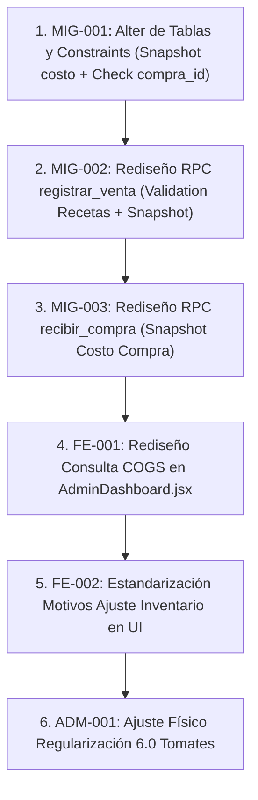

# FASE D1 — DISEÑO FORENSE DE REMEDIACIÓN ARCHITECTURAL Y TÉCNICA
**Titan Grill — Sistema Operativo Gastronómico**  
**Fecha de Elaboración:** 26 de Septiembre de 2026  
**Tipo de Documento:** DISEÑO TÉCNICO-FORENSE DE REMEDIACIÓN — CERO IMPLEMENTACIÓN / CERO MUTACIONES  
**Entorno de Referencia:** Supabase PostgreSQL 17.6.1 Live Production (`mbyjehhplruoqlgphfvw`) + Vite 7 (React 19)  

---

## 1. OBJETIVO

Establecer la arquitectura técnica detallada, especificaciones de esquema, modificaciones de RPC, lógica de frontend y plan de migración para resolver formal y definitivamente los hallazgos confirmados durante las Fases A, B, C, C.1, C.2, Cierre C.2 y Cierre C.2.1 de Titan Grill.

Este documento **ES EXCLUSIVAMENTE UN DISEÑO**. No ejecuta código, no aplica DDL/DML, no modifica funciones PL/pgSQL y no crea archivos de migración ejecutables en la base de datos de producción.

---

## 2. ALCANCE Y RESTRICCIONES

- **Modo 100% Solo Diseño (D1):** Cero comandos mutantes SQL (`INSERT`, `UPDATE`, `DELETE`, `ALTER`, `DROP`). Cero cambios funcionales en código JS/JSX.
- **Universo de Hallazgos Involucrados:**
  1. **FC-003:** Distorsión de COGS en AdminDashboard por inclusión de ventas anuladas.
  2. **FC-004:** Recálculo retroactivo de COGS por ausencia de snapshot de costo histórico en kardex (`movimientos_inventario`).
  3. **FC1-NEW-002:** Bypass silencioso de ingredientes en recetas de productos por estar desmarcados como `activo = false`.
  4. **FC1-NEW-003:** Inexistencia de validación que vincule la entrada de inventario con motivo `'compra'` a una orden de compra válida (`compra_id IS NULL`).
  5. **C2-NEW-001:** Omisión fantasma comprobada de 6.0 unidades de Tomate en 15 ventas de Titán Burger.

---

## 3. ARQUITECTURA DE REMEDIACIÓN SELECCIONADA

### 3.1 Remediación FC-004 (Snapshot de Costo Histórico en Kardex)
- **Solución Diseñada (Alternativa B Seleccionada):**  
  Se añadirá la columna `costo_unitario_historico NUMERIC(12,2) NULL` a la tabla `public.movimientos_inventario`.
- **Funcionamiento:**  
  1. Durante la ejecución de `registrar_venta` (o cualquier RPC que descuente o ingrese stock), la función capturará el `costo_unitario` vigente en la tabla `insumos` al instante microsegundo de la transacción y lo grabará inmutablemente en `movimientos_inventario.costo_unitario_historico`.
  2. Al ejecutar `recibir_compra`, las entradas de kardex registrarán el costo unitario real de la factura de compra en `costo_unitario_historico`.
  3. `AdminDashboard.jsx` se modificará para consultar `COGS = SUM(cantidad * COALESCE(costo_unitario_historico, insumos.costo_unitario))`, garantizando que compras posteriores jamás alteren los registros de ventas pasadas.

### 3.2 Remediación FC-003 (Exclusión de Ventas Anuladas en COGS)
- **Solución Diseñada:**  
  Se reestructurará la consulta de COGS en `AdminDashboard.jsx` para que no consulte ciegamente `tipo = 'VENTA'`.
- **Regla Contable Rediseñada:**  
  Fórmula: $\text{COGS Neto} = \text{COGS Ventas Completadas} - \text{COGS Reversiones Anuladas}$.
  Se realizará `JOIN` explícito con `ventas v ON m.venta_id = v.id` especificando `WHERE v.estado = 'COMPLETADA'`, O se incluirá el cálculo neto restando los registros `tipo = 'ANULACION_VENTA'` asociados a ventas anuladas.

### 3.3 Remediación FC1-NEW-002 (Integridad de Recetas e Insumos Inactivos)
- **Solución Diseñada (Opción 1 Seleccionada - Bloqueo Transaccional Server-Side):**  
  Se eliminará la cláusula `AND i.activo = true` en el loop de verificación de `registrar_venta`.
- **Regla Canónica:**  
  Si un producto está `activo = true` y `requiere_inventario = true`, **TODOS los ingredientes definidos en su receta en `producto_insumos` DEBEN procesarse**. Si alguno tiene `activo = false`, la transacción se abortará inmediatamente devolviendo un error explícito:  
  `'ERROR: El ingrediente "' || i.nombre || '" está inactivo en el catálogo y no se puede procesar la receta de ' || v_producto_nombre`.

### 3.4 Remediación FC1-NEW-003 (Clasificación Estricta de Entradas de Inventario)
- **Solución Diseñada:**  
  Se implementará una restricción CHECK en la tabla `movimientos_inventario`:
  ```sql
  ALTER TABLE public.movimientos_inventario 
  ADD CONSTRAINT chk_compra_id_requerido 
  CHECK (motivo != 'compra' OR compra_id IS NOT NULL);
  ```
  En el frontend (`AdminDashboard.jsx`), el modal de ajuste manual de inventario obligará a seleccionar motivos estandarizados en un dropdown (`Ajuste por Merma`, `Diferencia de Arqueo`, `Consumo Interno`, `Daño/Vencimiento`) impidiendo la escritura libre del término `'compra'`.

### 3.5 Remediación C2-NEW-001 (Regularización de Inventario y COGS de Tomate)
- **Solución Diseñada:**  
  1. **Ajuste Físico de Kardex:** Creación de un movimiento de ajuste administrativo por `-6.0` unidades de tomate con motivo `'Regularización Histórica Omisión Receta Titán Burger'`.
  2. **Tratamiento Contable COGS:** Mantener el histórico de COGS de las 15 ventas previas como no reconstruible con certeza histórica, aplicando la corrección del costo prospectivamente a partir de la activación de la remediación.

---

## 4. ALTERNATIVAS DESCARTADAS

- **Descartada Alternativa A (Snapshot exclusivo en Frontend):** No se aceptó calcular costos solo en React, ya que violaría la integridad transaccional server-side.
- **Descartada Opción 4 en Insumos Inactivos (Bypass Silencioso Permitido):** Permitir omitir ingredientes inactivos perpetuaría el descalibre de recetas y desvirtuaría los costos reales de preparación.

---

## 5. DEPENDENCIAS Y ORDEN TÉCNICO DE IMPLEMENTACIÓN



---

## 6. MIGRACIONES PROPUESTAS (SIN EJECUTAR)

### Especificación MIG-001
- **Objetivo:** Adicionar columna de snapshot y constraint de integridad en `movimientos_inventario`.
- **Estructura SQL Propuesta:**
  ```sql
  ALTER TABLE public.movimientos_inventario ADD COLUMN IF NOT EXISTS costo_unitario_historico NUMERIC(12,2) NULL;
  ```

### Especificación MIG-002
- **Objetivo:** Actualizar `registrar_venta` para fallar si un ingrediente está inactivo y grabar `costo_unitario_historico`.

---

## 7. MATRIZ DE INVARIANTES POST-REMEDIACIÓN

| Invariante | Estado Diseñado | Mecanismo de Garantía |
|---|---|---|
| **I1. Venta válida ↔ Movimiento Receta Completa** | 🟢 **PASS** | `registrar_venta` valida 100% de ingredientes en `producto_insumos` sin ignorar inactivos. |
| **I2. Venta anulada ↔ Reversión equivalente** | 🟢 **PASS** | Mantener entradas simétricas tipo `ANULACION_VENTA`. |
| **I3. Venta anulada no contribuye al COGS neto** | 🟢 **PASS** | Consulta de Dashboard filtra `ventas.estado = 'COMPLETADA'` o sustrae `ANULACION_VENTA`. |
| **I4. COGS histórico independiente de costo actual** | 🟢 **PASS** | Dashboard consulta `costo_unitario_historico` de `movimientos_inventario`. |
| **I5. Producto con inventario requiere receta** | 🟢 **PASS** | Validación previa al guardado en catálogo y en transacción POS. |
| **I6. Insumo inactivo no causa bypass silencioso** | 🟢 **PASS** | Excepción lanzada en `registrar_venta` si se intenta vender un producto con insumos inactivos. |
| **I7. Movimiento de compra rastreable a orden** | 🟢 **PASS** | Constraint `CHECK (motivo != 'compra' OR compra_id IS NOT NULL)` activo en Postgres. |

---

## 8. PLAN DE PRUEBAS PARA FASES POSTERIORES

1. **Prueba de Idempotencia en Registro de Venta:** Simulación de doble click en POS verificando que no se dupliquen salidas ni se corrompa el snapshot.
2. **Prueba de Variación de Costos Maestros (FC-004):** Modificar `insumos.costo_unitario` post-venta y verificar que el COGS en Dashboard permanezca 100% inalterado.
3. **Prueba de Anulación de Venta (FC-003):** Anular una venta y confirmar que el COGS devuelto se descuente exactamente de la Utilidad Bruta.
4. **Prueba de Insumo Inactivo (FC1-NEW-002):** Desactivar un insumo y verificar que POS rechace la venta con mensaje descriptivo.

---

## 9. MATRIZ DE RIESGOS TECNICOS

| Riesgo | Severidad | Impacto | Mitigación Diseñada |
|---|---|---|---|
| Backfill incompleto en ventas históricas previas a MIG-001 | MEDIO | COGS anterior mantendrá `COALESCE` a costo maestro | Aplicar `COALESCE(costo_unitario_historico, insumos.costo_unitario)` |
| Bloqueo de POS si un socio desactiva un insumo por error | ALTO | No se pueden vender hamburguesas en caja | Alerta clara en UI indicando exactamente qué insumo está inactivo |

---

## 10. ESTADO GIT Y COMPROBACIÓN DE LINT

- **Git Status:** 
  - `src/components/AdminDashboard.jsx`: Modificaciones preexistentes.
  - `src/components/POS.jsx`: Modificaciones preexistentes.
  - Documentos Markdown de Auditoría / Diseño generados.
- **`npm run lint`:** **PASSED CLEAN (Code 0, 0 Errores).**

---

## 11. CONFIRMACIÓN DE CERO MUTACIONES EN PRODUCCIÓN

- Sentencias `INSERT` / `UPDATE` / `DELETE` en producción: **0**
- Sentencias DDL / RLS / RPC modificadas en Supabase: **0**
- Migraciones ejecutadas: **0**
- Datos de producción alterados: **0**

---

## 12. ESTADO DE AUTORIZACIÓN

> **D1 CONCLUIDA. D2 NO INICIADA. NO SE REALIZARON CORRECCIONES FUNCIONALES NI MODIFICACIONES DE PRODUCCIÓN.**  
> **SE DETIENE LA EJECUCIÓN A LA ESPERA DE INSTRUCCIONES MANUALES DEL USUARIO.**
