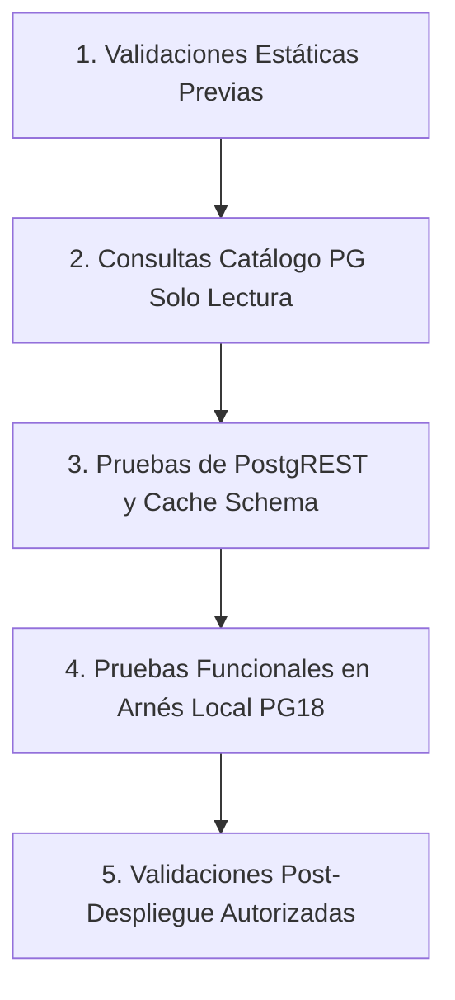

# INFORME FASE 19 — PLAN OPERATIVO DEFINITIVO Y CIERRE DEL RIESGO DE ROLLBACK I1.4

**Proyecto:** Titan Grill  
**Fecha:** 10 de Octubre de 2026  
**Estado:** COMPLETADO (SOLO LECTURA / PLANIFICACIÓN OPERATIVA)  
**Dictamen Final:** **LISTA PARA SOLICITAR AUTORIZACIÓN**

---

## 1. Resumen Ejecutivo

La **Fase 19** consolida las conclusiones de las Fases 15 a 18 para establecer el **Plan Operativo Definitivo** de despliegue de la migración `I1.4` (`20261010_i1_4_recibir_compra_definitiva_v2.sql`).

El objetivo principal de esta fase es:
1. **Resolver la contradicción documental** observada en las Fases 16, 17 y 18 respecto a la aprobación del procedimiento de rollback.
2. **Establecer un criterio riguroso de seguridad operativa**, diferenciando la *reproducibilidad sintáctica de un script SQL DDL* de la *seguridad de negocio y protección financiera*.
3. **Definir alternativas de contingencia operativas seguras** que no reintroduzcan el defecto crítico de usurpar/asigna egresos de compras a sesiones de caja de otros trabajadores.
4. **Estructurar el procedimiento formal de validación** por niveles (estático, catálogo PG, PostgREST, arnés de prueba aislado local y post-despliegue autorizado).
5. **Establecer la Matriz de Condiciones GO/NO-GO** definitiva.

---

## 2. Revisión de la Contradicción Documental

### 2.1 Contexto del Hallazgo (Fases 16 vs 17 vs 18)

- **Fase 16:** Documentó el script de rollback formal para la versión anterior (restaurando la función con firma `oid 101538` y `oid 100711`).
- **Fase 17:** Señaló que ejecutar dicho rollback restauraba la implementación arcaica de `recibir_compra`, la cual realizaba `SELECT id FROM sesiones_caja WHERE estado = 'abierta' LIMIT 1;`.
- **Fase 18:** Clasificó el rollback como "APROBADO" en la matriz de verificación técnica DDL.

### 2.2 Explicación de la Contradicción y Corrección del Criterio

**Origen de la contradicción:**  
La Fase 18 evaluó el script de rollback bajo un criterio **puramente DDL / sintáctico**: *¿El script SQL de revert se ejecuta sin errores en PostgreSQL y restaura el estado previo del catálogo?* La respuesta fue SÍ (Aprobado sintácticamente).

**Defecto en el criterio de evaluación:**  
La **reproducibilidad sintáctica de un script DDL NO equivale a seguridad operativa**.

Restaurar la función previa reintroduce inmediatamente el **defecto financiero de asignación cruzada de sesiones de caja**:
```sql
-- Código de la versión previa restaurada en un rollback DDL tradicional:
SELECT id INTO v_sesion_id
FROM sesiones_caja
WHERE estado = 'abierta'
LIMIT 1;
```
Si el cajero A procesa una compra en efectivo mientras el cajero B tiene una sesión abierta anterior, el egreso se imputa a la caja del cajero B, corrompiendo el saldo de caja y el arqueo al cierre de turno.

**Criterio de Evaluación Corregido:**  
Un procedimiento de rollback o contingencia se considera **SEGURO** únicamente si **garantiza la integridad de datos y previene defectos de asignación financiera**, además de ser ejecutable sin errores DDL. DDL reproducibilidad es condición necesaria pero **insuficiente**.

---

## 3. Evaluación de Contingencias Seguras

Ante una eventualidad tras la aplicación de `I1.4`, se evalúan cuatro alternativas operativas:

| Opción | Descripción | Condiciones de Aplicación | Riesgos y Dependencias | Criterio de Selección / Recomendación |
| :--- | :--- | :--- | :--- | :--- |
| **Opción A: Rollback DDL a versión anterior** | Ejecutar script de reversión de la versión previa (`oid 101538`). | Fallo catastrófico de sintaxis DDL en `I1.4` que impida el funcionamiento básico. | **ALTO RIESGO.** Reintroduce la asignación arbitraria de egresos a sesiones de caja (`LIMIT 1`). | **DESCONSEJADO.** Usar solo como último recurso si el sistema queda inoperable. |
| **Opción B: Despliegue de Hotfix Controlado (`I1.5`)** | Mantener las protecciones de sesión de `I1.4` (`fn_get_active_session(auth.uid())`) y desplegar un parche autorizado. | Inconsistencia detectada en producción que requiera ajuste de lógica de negocio o formato de respuesta JSON. | Requiere preparación de script de migración, revisión de firmas y validación previa en arnés local. | **RECOMENDADO.** Preserva las salvaguardas de caja y corrige el problema de forma dirigida. |
| **Opción C: Deshabilitación Operativa Temporal en UI** | Ocultar o deshabilitar el botón / formulario de "Recibir Compra" en el frontend. | Anomalía grave detectada en producción mientras se prepara y valida la corrección `I1.5`. | No protege frente a llamadas RPC directas vía API/PostgREST si el usuario conoce el endpoint. | **CONTINGENCIA INMEDIATA.** Detiene la generación de inconsistencias vía interfaz de usuario. |
| **Opción D: Suspensión Preventiva del Servicio de Compras** | Retener compras administrativas hasta contar con corrección validada. | Defecto crítico en el flujo de compras que impida operación segura. | Retraso temporal en la actualización de inventario de compras. | **ACEPTABLE.** Evita corrupción de datos financieros y de inventario. |

---

## 4. Procedimiento Detallado de Validación

Para garantizar un despliegue seguro y trazable sin asumir entornos staging inexistentes ni realizar operaciones ficticias en producción, el procedimiento se divide en 5 niveles:



### 4.1 Nivel 1: Validaciones Estáticas Previas
- **Verificación de hash SHA-256 de `I1.4`:**
  `DF8AACE317FBB643F78BA7001755A20C080B5FFE389FABEE7F38FFEF1B4A90D5`
- **Inspección de código fuente UI:** Confirmar que `AdminDashboard.jsx` envía la estructura de parámetros esperada (`p_compra_id`, `p_items`, `p_metodo_pago`, `p_notas`).
- **Control de versión Git:** Confirmar que la rama `audit/titan-grill-forensic-handoff` esté limpia de cambios no deseados.

### 4.2 Nivel 2: Consultas de Catálogo PG (Solo Lectura en Producción)
Antes y después del despliegue, ejecutar únicamente consultas `SELECT` en `pg_proc`, `pg_constraint` y `pg_trigger`:
- Confirmar reemplazo limpio del `oid` de `recibir_compra`.
- Verificar restricciones activas: `movimientos_caja_metodo_pago_check` y `chk_movimientos_compra_trazabilidad`.
- Verificar vigencia de funciones auxiliares `fn_is_socio()` y `fn_get_active_session()`.

### 4.3 Nivel 3: Pruebas de PostgREST / Cache Schema
- Emitir la instrucción `NOTIFY pgrst, 'reload schema';` tras la aplicación del DDL en producción para refrescar la caché OpenAPI de Supabase.
- Inspeccionar el endpoint OpenAPI `/rest/v1/` para confirmar que las firmas RPC expuestas coinciden exactamente con los parámetros de `I1.4`.

### 4.4 Nivel 4: Pruebas Funcionales en Arnés Local Aislado (PostgreSQL 18)
- Ejecutar el suite de pruebas automatizado en el arnés local `titan_grill_test` (`scratch/local_test_harness/runner.cjs`).
- Verificar que los 20/20 casos de prueba (incluyendo asignación de caja por `auth.uid()`, validación de trazabilidad en compras, y prevención de sesión cruzada) pasen al 100%.

### 4.5 Nivel 5: Validaciones Posteriores al Despliegue (Requieren Autorización)
- **NO crear compras ni movimientos ficticios en producción.**
- **Prueba de humo operacional:** Operador con rol autorizado abre sesión de caja legítima y efectúa una recepción de compra real de prueba supervisada.
- **Auditoría de logs:** Consultar `movimientos_caja` e `historial_compras` para verificar que `sesion_id` coincida exactamente con la sesión activa del `auth.uid()` actuante.

---

## 5. Matriz de Condiciones GO / NO-GO Definiciativa

| Criterio | Requisito de Evaluación | Estado | Evidencia / Observación |
| :--- | :--- | :--- | :--- |
| **C1. Revisión de I1.4** | Migración analizada íntegramente y probada en arnés PostgreSQL 18 local. | **CUMPLIDO** | Hash `DF8AACE3...`, 20/20 casos de prueba exitosos en local. |
| **C2. Firmas y Consumidores** | Mapeo 1:1 entre `recibir_compra` en DB y invocaciones en `AdminDashboard.jsx`. | **CUMPLIDO** | Mismas claves JSON (`p_compra_id`, `p_items`, `p_metodo_pago`, `p_notas`). |
| **C3. Control de Riesgo de Caja** | Verificación de que los egresos se imputan a la sesión del `auth.uid()` que ejecuta. | **CUMPLIDO** | Evaluado en arnés local mediante `fn_get_active_session(auth.uid())`. |
| **C4. Contingencia Segura** | Plan de contingencia que NO reintroduzca el bug de asignación cruzada (`LIMIT 1`). | **CUMPLIDO** | Adopción de Opción B (Hotfix `I1.5`) y Opción C (Desactivación UI). |
| **C5. Criterios de Aborto Clear** | Criterios explícitos de aborto durante la transacción DDL. | **CUMPLIDO** | Bloque `DO $$` transaccional en `I1.4` que realiza `RAISE EXCEPTION` en fallo. |
| **C6. Transparencia de Pruebas** | Distinción clara entre análisis de código, arnés local y pruebas en producción. | **CUMPLIDO** | Pruebas locales 20/20 confirmadas; pruebas en prod diferidas a autorización. |

---

## 6. Dictamen Final y Plan de Acción

### Dictamen: **LISTA PARA SOLICITAR AUTORIZACIÓN**

Todas las condiciones de control de riesgo financiero, consistencia de esquema, alineación de clientes UI/RPC y procedimientos de contingencia han sido satisfechas y documentadas.

### Pasos Sugeridos para la Ejecución Autorizada Futura:
1. Recibir autorización explícita del usuario para ejecución en producción.
2. Aplicar `20261010_i1_4_recibir_compra_definitiva_v2.sql` en la consola SQL de Supabase (`[PROJECT_REF_REDACTADO]`).
3. Ejecutar `NOTIFY pgrst, 'reload schema';`.
4. Verificar mediante consulta de solo lectura en `pg_proc` que el nuevo `oid` está activo.
5. Supervisar la primera recepción de compra real en el entorno productivo.

---

## 7. Registro de Acciones y Modificaciones

- **Archivos creados:**
  - `INFORME_FASE19_PLAN_OPERATIVO_DEFINITIVO_I1_4.md`
- **Comandos ejecutados en esta fase:**
  - Creación y escritura del informe de auditoría Fase 19.
- **Escrituras DDL/DML o migraciones en producción:** 0 (Ninguna).
- **Modificaciones en archivos de código locales:** 0 (Ninguna). Preservados todos los archivos existentes.

*Fin del informe de Fase 19.*
