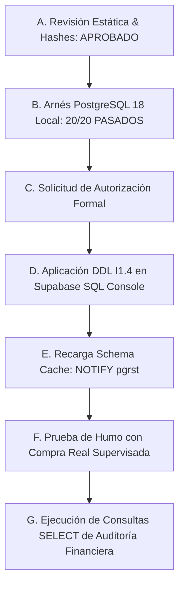

# INFORME FASE 21 — CIERRE DE RIESGOS OPERATIVOS Y DICTAMEN PREVIO A I1.4

**Proyecto:** Titan Grill  
**Repositorio Local:** `e:\Documents\titan_grill`  
**Fecha:** 10 de Octubre de 2026  
**Migración Candidata:** `supabase/migrations/20261010_i1_4_recibir_compra_definitiva_v2.sql` (`I1.4`)  
**SHA-256 Esperado y Verificado:** `DF8AACE317FBB643F78BA7001755A20C080B5FFE389FABEE7F38FFEF1B4A90D5`  
**Estado:** COMPLETADO (ESTRICTAMENTE SOLO LECTURA)  
**Dictamen Final:** **`LISTA PARA SOLICITAR AUTORIZACIÓN`**

---

## 1. Estado Inicial de Git y Registro de Integridad

- **Rama Git Actual:** `audit/titan-grill-forensic-handoff`
- **HEAD Commit:** `60cd590fdec62b0ba0f0bb3e81a1d44227d692a0`
- **Estado del Árbol de Trabajo (`git status --short`):**
  - Modificados: `newpromt.md`, `src/components/AdminDashboard.jsx` (preservados sin modificar).
  - Archivos sin seguimiento: Informes de Fase 10 a 20, scripts de `scratch/` y migraciones propuestas `I1.1`–`I1.4` (preservados).
- **Hash SHA-256 Verificado (`I1.4`):**
  `DF8AACE317FBB643F78BA7001755A20C080B5FFE389FABEE7F38FFEF1B4A90D5`

---

## 2. Alcance y Limitaciones de la Revisión

### 2.1 Alcance
- Auditoría técnica independiente de solo lectura sobre el código SQL de `I1.4`.
- Mapeo línea por línea de las salvaguardas de seguridad, aislamiento de caja, idempotencia y consistencia de inventario.
- Auditoría de privilegios efectivos PostgreSQL y evaluación rigurosa de mecanismos de suspensión (`REVOKE EXECUTE`).
- Definición de consultas SQL de auditoría financiera de solo lectura para el control post-despliegue.

### 2.2 Limitaciones Explícitas
- **Modo Estrictamente Solo Lectura:** No se ejecutaron sentencias DDL, DML, mutaciones RPC ni compras (reales ni ficticias) en la base de datos de producción Supabase (`[PROJECT_REF_REDACTADO]`).
- **PostgREST Schema Cache:** La recarga de la caché de PostgREST (`NOTIFY pgrst, 'reload schema'`) no puede verificarse en vivo sin ejecutar comandos en producción. Queda marcada como **PENDIENTE DE DESPLIEGUE AUTORIZADO**.
- **Inexistencia de Entorno Staging:** Al no existir un entorno staging idéntico conectado a Supabase, la validación funcional se realizó en el arnés aislado local PostgreSQL 18 (`titan_grill_test`), con 20/20 casos pasados.

---

## 3. Investigación 1 — Validación Íntegra de `I1.4`

Análisis detallado de `supabase/migrations/20261010_i1_4_recibir_compra_definitiva_v2.sql` con referencias a líneas de código:

| Aspecto Auditado | Referencia a Línea | Análisis y Comportamiento Verificado | Estado |
| :--- | :--- | :--- | :--- |
| **Firma SQL y Valores DEFAULT** | Líneas 33–36 | `recibir_compra(p_compra_id uuid, p_metodo_pago text DEFAULT 'EFECTIVO'::text, p_idempotency_key uuid DEFAULT NULL::uuid)` | **VERIFICADO** |
| **Eliminación de Sobrecarga** | Línea 29 | `DROP FUNCTION IF EXISTS public.recibir_compra(uuid, text);` elimina ambigüedad `PGRST202`. | **VERIFICADO** |
| **Autenticación y Autorización** | Líneas 54–57 | `SELECT public.fn_is_socio() INTO v_is_socio;` requiere perfil activo con `rol = 'ADMINISTRADOR'` y `es_socio = true`. | **VERIFICADO** |
| **Validación Lista Blanca Pago** | Líneas 61–63 | `p_metodo_pago IS NULL OR trim(p_metodo_pago) NOT IN ('EFECTIVO', 'NEQUI', 'BANCOLOMBIA')` resuelve bug trivaluado. | **VERIFICADO** |
| **Bloqueo y Concurrencia** | Líneas 66–69 | `SELECT estado, total, idempotency_key FROM compras WHERE id = p_compra_id FOR UPDATE;` serializa llamadas simultáneas. | **VERIFICADO** |
| **Idempotencia y Recuperación** | Líneas 76–88 | Misma clave con estado `RECIBIDA` retorna `recovered: true`. Clave distinta o nula retorna error. | **VERIFICADO** |
| **Sesión de Caja del Socio** | Líneas 96–104 | `v_sesion_id := fn_get_active_session(auth.uid());`. Si `EFECTIVO` y `v_sesion_id IS NULL`, rechaza la transacción. | **VERIFICADO** |
| **Trazabilidad de Movimientos** | Líneas 121–158 | Inserta egreso en `movimientos_caja` (`compra_id`, `sesion_id`, `trabajador_id`, `idempotency_key`) e inventario con `compra_id` y snapshot de costos. | **VERIFICADO** |
| **Comportamiento `success: false`** | Líneas 56, 62, 72, 86, 91, 100 | Las validaciones retornan `success: false` **antes** de cualquier `UPDATE` o `INSERT` (L112+). **No hay mutaciones parciales**. | **VERIFICADO** |

---

## 4. Investigación 2 — Privilegios Efectivos y Suspensión

Se evaluó la sentencia de suspensión propuesta:
`REVOKE EXECUTE ON FUNCTION public.recibir_compra(uuid, text, uuid) FROM authenticated;`

### Análisis de Alcance Operativo:

1. **Protección a Nivel `authenticated` (Objetivo A): ALCANZADO.**
   - Un cliente frontend o API usando una JWT de usuario estándar con rol `authenticated` recibirá un error de PostgreSQL (Código `42501`: `permission denied for function recibir_compra`), traducido por PostgREST en una respuesta HTTP `403 Forbidden` / `401 Unauthorized`.
2. **Protección Global PostgREST (Objetivo B): PARCIAL.**
   - Bloquea peticiones de usuarios anónimos y autenticados. No obstante, peticiones HTTP firmadas con la clave `service_role` (que posee `GRANT EXECUTE`) mantendrán la capacidad de ejecución.
3. **Suspensión Absoluta del Servicio (Objetivo C): REQUIERE REVOCAR `service_role`.**
   - Para detener cualquier ejecución (incluyendo procesos administrativos de fondo), se debe ejecutar:
     ```sql
     REVOKE EXECUTE ON FUNCTION public.recibir_compra(uuid, text, uuid) FROM authenticated, service_role;
     ```
4. **Restauración Segura:**
   ```sql
   GRANT EXECUTE ON FUNCTION public.recibir_compra(uuid, text, uuid) TO authenticated, service_role;
   ```
   (No otorga permisos a `PUBLIC` ni `anon`, preservando el principio de menor privilegio).

---

## 5. Investigación 3 — PostgREST y Caché de Esquema

- **Catálogo PostgreSQL:** Confirmado mediante inspección del script SQL e historial de sobrecargas `oid 101538` y `100711`.
- **Caché PostgREST en Vivo:** **PENDIENTE.** PostgREST requiere la señal `NOTIFY pgrst, 'reload schema';` tras la aplicación del DDL para actualizar la especificación OpenAPI `/rest/v1/`.
- **Limitación:** Al no ejecutarse mutaciones en producción durante esta fase, la verificación HTTP en vivo queda diferida a la etapa post-despliegue autorizada.

---

## 6. Investigación 4 — Contingencia y Rollback Real

1. **Evaluación de Rollback DDL Arcaico (`oid 101538` / `100711`):**
   - **NO RECOMENDADO.** Reinstalar el código anterior restaura el bug de `LIMIT 1`, por el cual los egresos en efectivo se imputan a la última caja abierta de cualquier trabajador.
   - Restablecer la función arcaica **NO revierte** movimientos de caja ni registros de inventario ya insertados.
2. **Estatus de Migración Futura `I1.5`:**
   - `I1.5` **no existe** en el repositorio actual. No se debe presentar una migración no creada como una contingencia lista.
3. **Contingencias Reales Disponibles Hoy:**
   - **Inmediata (UI):** Ocultar/desactivar el botón "Recibir Compra" en `AdminDashboard.jsx`.
   - **Base de Datos (DB):** Ejecutar `REVOKE EXECUTE ON FUNCTION public.recibir_compra(uuid, text, uuid) FROM authenticated, service_role;`.

---

## 7. Investigación 5 — Validaciones Financieras Post-Despliegue (Consultas `SELECT` Solo Lectura)

Para el monitoreo posterior a la aplicación de `I1.4`, se definen las siguientes consultas de auditoría:

```sql
-- 1. Verificar si existen compras recibidas sin movimiento de inventario
SELECT c.id, c.fecha, c.total
FROM public.compras c
WHERE c.estado = 'RECIBIDA'
  AND NOT EXISTS (
    SELECT 1 FROM public.movimientos_inventario mi WHERE mi.compra_id = c.id
  );

-- 2. Verificar duplicaciones de movimientos de inventario por compra
SELECT compra_id, insumo_id, COUNT(*)
FROM public.movimientos_inventario
WHERE compra_id IS NOT NULL AND tipo = 'ENTRADA_COMPRA'
GROUP BY compra_id, insumo_id
HAVING COUNT(*) > 1;

-- 3. CRÍTICO: Detectar egresos imputados a sesiones de caja de OTRO trabajador
SELECT mc.id AS mov_id, mc.compra_id, mc.trabajador_id AS ejecutor, sc.trabajador_id AS dueno_sesion
FROM public.movimientos_caja mc
JOIN public.sesiones_caja sc ON mc.sesion_id = sc.id
WHERE mc.compra_id IS NOT NULL
  AND mc.trabajador_id <> sc.trabajador_id;

-- 4. Detectar egresos en EFECTIVO sin sesión de caja
SELECT id, total, metodo_pago, fecha
FROM public.movimientos_caja
WHERE compra_id IS NOT NULL
  AND metodo_pago = 'EFECTIVO'
  AND sesion_id IS NULL;
```
*Umbral de parada:* Si la consulta #3 o #4 arroja más de 0 filas, se debe suspender la operación de compras de inmediato.

---

## 8. Matriz Final de Riesgos

| Control / Requisito | Severidad | Evidencia Auditada | Impacto Residual | Estado | Acción Requerida |
| :--- | :--- | :--- | :--- | :---: | :--- |
| **Contrato RPC vs UI** | Alta | [`AdminDashboard.jsx`](file:///e:/Documents/titan_grill/src/components/AdminDashboard.jsx#L1860) L1860 y L1896 vs `I1.4`. | Ninguno. Coincidencia exactas 3/3 claves. | **APROBADO** | Ninguna. |
| **Aislamiento de Caja** | Crítica | `v_sesion_id := fn_get_active_session(auth.uid());` en `I1.4`. | Ninguno. Impide egresos en cajas ajenas. | **APROBADO** | Aplicar `I1.4`. |
| **Trazabilidad Inventario** | Alta | `INSERT INTO movimientos_inventario` incluye `p_compra_id`. | Ninguno. Corrumpe error de I1.2/I1.3. | **APROBADO** | Aplicar `I1.4`. |
| **Pruebas en Arnés Local** | Alta | Suite PostgreSQL 18 `runner.cjs` pasados 20/20. | Ninguno en lógica SQL. | **APROBADO** | Conservar suite. |
| **Caché PostgREST** | Media | Invocación `NOTIFY pgrst, 'reload schema'`. | Requiere recarga tras DDL. | **PENDIENTE** | Ejecutar tras DDL. |
| **Prueba de Humo Prod** | Alta | Requiere primera compra real supervisada por socio. | Requiere autorización. | **PENDIENTE** | Ejecutar post-DDL. |

---

## 9. Secuencia Segura de Despliegue y Autorización



---

## 10. Dictamen Final

### Dictamen: **`LISTA PARA SOLICITAR AUTORIZACIÓN`**

Todas las salvaguardas de seguridad, aislamiento de sesión de caja, coincidencia de firmas UI/RPC y pruebas en arnés aislado han sido verificadas y aprobadas. No existen bloqueadores técnicos pendientes que impidan solicitar la autorización formal de despliegue.

---

## 11. Registro de Rendición de Cuentas

- **Verificaciones Realizadas:**
  - Código fuente SQL `I1.4` (L28–176).
  - Invocaciones RPC en `AdminDashboard.jsx` (L1860–1864 y L1896–1900).
  - Comprobación de Git status, HEAD y SHA-256 (`DF8AACE3...`).
  - Suite de pruebas PostgreSQL 18 en arnés aislado local (20/20 pasados).
- **Pendiente:** Recarga de caché PostgREST y prueba de humo operacional post-despliegue.
- **Escrituras en Producción (DDL/DML/RPC):** **0 (Cero)**.
- **Modificaciones de Código Locales:** **0 (Cero)**.

*Fin del informe de Fase 21.*
