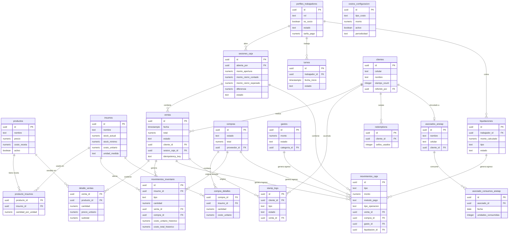

# LÓGICA DEL SISTEMA — TITÁN GRILL

> **Versión del documento:** 2026-11-12  
> **Generado por:** análisis estático del código fuente (frontend JSX + migraciones SQL de Supabase)  
> **Convenciones:** "NO IMPLEMENTADO" = el código no lo hace. "NO CONFIRMADO" = evidencia parcial, ver nota.

---

## Tabla de contenido

1. [Arquitectura](#1-arquitectura)
2. [Modelo de datos](#2-modelo-de-datos)
3. [Fórmulas y reglas de negocio](#3-fórmulas-y-reglas-de-negocio)
4. [Validaciones e integridad](#4-validaciones-e-integridad)
5. [Historial de migraciones](#5-historial-de-migraciones)
6. [Integraciones externas](#6-integraciones-externas)
7. [Escalabilidad multi-restaurante](#7-escalabilidad-multi-restaurante)
8. [Pendientes y riesgos técnicos](#8-pendientes-y-riesgos-técnicos)

---

## 1. Arquitectura

### 1.1 Stack

| Capa | Tecnología | Versión confirmada |
|------|------------|-------------------|
| Frontend | React | 19 |
| Bundler | Vite | 7 |
| Lenguaje | JavaScript / JSX | Sin TypeScript |
| Enrutamiento | React Router | v7 (`react-router-dom`) |
| Estilos | Tailwind CSS | v4 (`@tailwindcss/postcss`) |
| Clases condicionales | `clsx` + `tailwind-merge` | — |
| Animaciones | Framer Motion | — |
| Gráficas | Recharts | — |
| Iconos | Lucide React | — |
| QR (generación) | `qrcode.react`, `react-qr-code` | — |
| QR (lectura) | `html5-qrcode` | — |
| Error boundaries | `react-error-boundary` | — |
| Backend / Base de datos | Supabase (Auth + PostgreSQL + RLS + RPC) | — |
| Linting | ESLint flat config | Cubre `**/*.{js,jsx}` |
| Tests | **NO IMPLEMENTADO** | No hay runner configurado |
| Hosting | NO CONFIRMADO | No hay configuración de hosting en el repo |

### 1.2 Rutas y módulos

| Ruta | Componente principal | Rol requerido | Tablas principales |
|------|---------------------|--------------|-------------------|
| `/` | Landing (inline en `App.jsx`) | Público | — |
| `/login` | Login (inline en `App.jsx`) | Público | `perfiles_trabajadores` |
| `/menu` | `DigitalMenu.jsx` | Público | `productos`, `categorias_gastos` |
| `/pos` | `POS.jsx` | TRABAJADOR / ADMIN | `ventas`, `detalle_ventas`, `clientes`, `sesiones_caja`, `movimientos_caja`, `insumos`, `producto_insumos`, `asociados_aneiap`, `asociado_consumos_aneiap` |
| `/admin` | `AdminDashboard.jsx` | ADMIN | Casi todas |
| `/admin/client/:clientId` | Panel cliente (en `AdminDashboard.jsx`) | ADMIN | `clientes`, `stamp_logs`, `redemptions` |

#### Pestañas de AdminDashboard

| Pestaña | Función principal | Tablas/RPCs |
|---------|------------------|-------------|
| Dashboard | KPIs, resumen financiero | `ventas`, `movimientos_caja`, `clientes`, `insumos`, `stamp_logs`, `redemptions` |
| POS integrado | Venta directa desde admin | (mismas que POS) |
| Inventario | CRUD insumos, alertas stock | `insumos`, `movimientos_inventario` |
| Recetas | CRUD producto_insumos, costo receta | `productos`, `producto_insumos`, `insumos`, `costos_configuracion` |
| Compras | Registrar y recibir órdenes | `compras`, `compra_detalles`, `proveedores`, `insumos` |
| Mermas | Registrar pérdida de insumos | `movimientos_inventario`, `insumos` — RPC `ajustar_stock_insumo` |
| Caja | Saldos por cuenta, transferencias, retiros | `movimientos_caja`, `sesiones_caja` |
| Nómina / Turnos | Registrar y pagar turnos | `turnos`, `liquidaciones` — RPCs `registrar_turno`, `pagar_turno`, `cerrar_y_pagar_turno` |
| Estado de resultados | P&L, margen, punto de equilibrio | RPC `fn_estado_resultados` |
| Fidelización | Clientes, sellos, premios | `clientes`, `stamp_logs`, `redemptions` |
| Analítica | Pareto 80/20, pronóstico | `ventas`, `detalle_ventas` (cálculo en frontend) |
| Configuración | Multiplicador precio, impuesto, costos fijos/variables | `costos_configuracion` |

### 1.3 Métricas del repositorio (aproximadas)

| Métrica | Valor |
|---------|-------|
| Archivos JSX principales | ~12 (App, AdminDashboard, POS, LoyaltyCard, DigitalMenu, WhatsAppButton, etc.) |
| Líneas JSX (aprox.) | ~12 000 (`AdminDashboard.jsx` ≈ 8 048, `POS.jsx` ≈ 2 000+) |
| Migraciones SQL | 24 archivos |
| Tablas confirmadas | 25 |
| Funciones/RPCs SQL | ~35 (ver sección 4) |
| Triggers SQL | ~10 |
| Tests automatizados | 0 |

---

## 2. Modelo de datos

### 2.1 Tablas principales

#### `productos`
| Columna | Tipo | Descripción |
|---------|------|-------------|
| `id` | uuid PK | — |
| `nombre` | text | Nombre del producto |
| `precio` | numeric | Precio de venta |
| `categoria` | text | Categoría |
| `activo` | boolean | Visible en POS/menú |
| `costo_receta` | numeric | Costo calculado (suma de insumos × cantidad) |

#### `insumos`
| Columna | Tipo | Descripción |
|---------|------|-------------|
| `id` | uuid PK | — |
| `nombre` | text | — |
| `stock_actual` | numeric | Stock vigente (solo modificable vía RPC) |
| `stock_minimo` | numeric | Umbral mínimo (ingresado manualmente) |
| `costo_unitario` | numeric | Último precio de compra (no promedio ponderado) |
| `unidad_medida` | text | Unidad base (gr, ml, und, etc.) |

#### `producto_insumos` (recetas)
| Columna | Tipo | Descripción |
|---------|------|-------------|
| `producto_id` | uuid FK → productos | — |
| `insumo_id` | uuid FK → insumos | — |
| `cantidad_por_unidad` | numeric | Cantidad de insumo por unidad vendida |

#### `ventas`
| Columna | Tipo | Descripción |
|---------|------|-------------|
| `id` | uuid PK | — |
| `fecha` | timestamptz | Momento de la venta |
| `total` | numeric | Total cobrado |
| `estado` | text | `'COMPLETADA'` / `'ANULADA'` |
| `cliente_id` | uuid FK → clientes | Nullable |
| `sesion_caja_id` | uuid FK → sesiones_caja | — |
| `idempotency_key` | text UNIQUE | Previene duplicados |
| `metodo_pago` | text | Método principal |

#### `detalle_ventas`
| Columna | Tipo | Descripción |
|---------|------|-------------|
| `venta_id` | uuid FK → ventas | — |
| `producto_id` | uuid FK → productos | — |
| `cantidad` | numeric | Unidades vendidas |
| `precio_unitario` | numeric | Precio al momento de la venta |
| `subtotal` | numeric | `cantidad × precio_unitario` |

#### `movimientos_inventario`
| Columna | Tipo | Descripción |
|---------|------|-------------|
| `id` | uuid PK | — |
| `insumo_id` | uuid FK → insumos | — |
| `tipo` | text | `VENTA`, `ENTRADA_COMPRA`, `MERMA`, `ANULACION_VENTA`, `AJUSTE` |
| `cantidad` | numeric | Negativa para consumos |
| `venta_id` | uuid FK → ventas | Nullable |
| `compra_id` | uuid FK → compras | Nullable |
| `costo_unitario_historico` | numeric | **Snapshot inmutable** del costo al momento |
| `costo_total_historico` | numeric | `ABS(cantidad) × costo_unitario_historico` (snapshot inmutable) |

#### `compras` / `compra_detalles`
| Columna | Tipo | Descripción |
|---------|------|-------------|
| `compras.id` | uuid PK | — |
| `compras.estado` | text | `'PENDIENTE'` / `'RECIBIDA'` / `'ANULADA'` |
| `compras.total` | numeric | Total de la orden |
| `compra_detalles.insumo_id` | uuid FK → insumos | — |
| `compra_detalles.cantidad` | numeric | En unidad de medida del insumo |
| `compra_detalles.costo_unitario` | numeric | Precio unitario pactado |
| `compra_detalles.presentacion` | text | Nombre de la presentación comercial |
| `compra_detalles.unidades_por_presentacion` | numeric | Factor de conversión |

#### `movimientos_caja`
| Columna | Tipo | Descripción |
|---------|------|-------------|
| `tipo` | text | `'INGRESO'` / `'EGRESO'` |
| `monto` | numeric | — |
| `metodo_pago` | text | `'EFECTIVO'` / `'NEQUI'` / `'BANCOLOMBIA'` |
| `tipo_operacion` | text | `'RETIRO'`, `'TRANSFERENCIA_INTERNA'`, etc. |
| `venta_id` | uuid FK → ventas | Nullable |
| `compra_id` | uuid FK → compras | Nullable |
| `gasto_id` | uuid FK → gastos | Nullable |
| `liquidacion_id` | uuid FK → liquidaciones | Nullable |

#### `sesiones_caja`
| Columna | Tipo | Descripción |
|---------|------|-------------|
| `id` | uuid PK | — |
| `abierta_por` | uuid FK → perfiles_trabajadores | — |
| `fecha_apertura` | timestamptz | — |
| `monto_apertura` | numeric | Efectivo inicial declarado |
| `fecha_cierre` | timestamptz | Nullable |
| `monto_cierre_contado` | numeric | Lo que contó el cajero |
| `monto_cierre_esperado` | numeric | Calculado por el servidor |
| `diferencia` | numeric | `contado - esperado` |
| `estado` | text | `'ABIERTA'` / `'CERRADA'` |

#### `gastos`
| Columna | Tipo | Descripción |
|---------|------|-------------|
| `id` | uuid PK | — |
| `monto` | numeric | — |
| `descripcion` | text | — |
| `fecha` | date | — |
| `estado` | text | `'ACTIVO'` / `'ANULADO'` |
| `categoria_id` | uuid FK → categorias_gastos | — |

#### `liquidaciones` (nómina)
| Columna | Tipo | Descripción |
|---------|------|-------------|
| `id` | uuid PK | — |
| `trabajador_id` | uuid FK → perfiles_trabajadores | — |
| `monto_calculado` | numeric | Tarifa del turno |
| `tipo` | text | `'POR_TURNO'` |
| `estado` | text | `'PENDIENTE'` / `'PAGADO'` |
| `fecha` | date | — |

#### `turnos`
| Columna | Tipo | Descripción |
|---------|------|-------------|
| `id` | uuid PK | — |
| `trabajador_id` | uuid FK → perfiles_trabajadores | — |
| `fecha_inicio` | timestamptz | No puede ser futura |
| `fecha_fin` | timestamptz | Nullable |
| `estado` | text | `'ACTIVO'` / `'CERRADO'` / `'ANULADO'` |

#### `clientes`
| Columna | Tipo | Descripción |
|---------|------|-------------|
| `id` | uuid PK | — |
| `celular` | text UNIQUE | — |
| `nombre` | text | — |
| `stamps_count` | integer | Sellos acumulados |
| `referido_por` | uuid FK → clientes | Nullable |

#### `stamp_logs`
| Columna | Tipo | Descripción |
|---------|------|-------------|
| `cliente_id` | uuid FK → clientes | — |
| `tipo` | text CHECK | `'VENTA'`, `'REFERIDO'`, `'MANUAL'`, `'PROMOCIONAL'`, `'PAGO_DEUDA'`, `'MIGRACION'` |
| `estado` | text | `'ACTIVO'` / `'ANULADO'` |
| `venta_id` | uuid FK → ventas | Nullable |

#### `redemptions`
| Columna | Tipo | Descripción |
|---------|------|-------------|
| `cliente_id` | uuid FK → clientes | — |
| `sellos_usados` | integer | Siempre 10 |
| `fecha` | timestamptz | — |

#### `asociados_aneiap`
| Columna | Tipo | Descripción |
|---------|------|-------------|
| `id` | uuid PK | — |
| `nombre` | text | — |
| `celular` | text UNIQUE | — |
| `cliente_id` | uuid FK → clientes | Nullable (vinculación) |

#### `asociado_consumos_aneiap`
| Columna | Tipo | Descripción |
|---------|------|-------------|
| `asociado_id` | uuid FK → asociados_aneiap | — |
| `fecha` | date | — |
| `unidades_consumidas` | integer | Acumulado del día |

#### `costos_configuracion`
| Columna | Tipo | Descripción |
|---------|------|-------------|
| `tipo_costo` | text | `'MULTIPLICADOR'`, `'IMPUESTO'`, `'FIJO'`, `'VARIABLE'` |
| `monto` | numeric | Valor |
| `activo` | boolean | — |
| `periodicidad` | text | `'DIARIO'`, `'SEMANAL'`, `'MENSUAL'`, `'ANUAL'`, `'PERMANENTE'` |

#### `perfiles_trabajadores`
| Columna | Tipo | Descripción |
|---------|------|-------------|
| `id` | uuid PK | — |
| `rol` | text | `'ADMINISTRADOR'` / `'TRABAJADOR'` |
| `es_socio` | boolean | Permisos de socio |
| `estado` | text | `'ACTIVO'` / `'INACTIVO'` |
| `tarifa_pago` | numeric | Monto fijo por turno |

#### `proveedores`
| Columna | Tipo | Descripción |
|---------|------|-------------|
| `id` | uuid PK | — |
| `nombre` | text | — |
| `contacto` | text | — |

#### `solicitudes_anulacion_venta`
| Columna | Tipo | Descripción |
|---------|------|-------------|
| `venta_id` | uuid FK → ventas | — |
| `estado` | text | `'PENDIENTE'` / `'APROBADA'` / `'RECHAZADA'` |
| `aprobador_id` | uuid FK → perfiles_trabajadores | Nullable |

#### Tablas de auditoría / legacy
- `admin_audit_log` — Auditoría de acciones administrativas.
- `admin_users_legacy` — Tabla legada, no usada activamente en el código actual.
- `admin_users` — VIEW sobre `perfiles_trabajadores`.

### 2.2 Diagrama Entidad-Relación (Mermaid)



---

## 3. Fórmulas y reglas de negocio

### a. Costo de receta de un producto

**Archivo:** `AdminDashboard.jsx` (cálculo frontend al mostrar recetas) + `registrar_venta` RPC (uso en movimientos).

**Fórmula:**

```
costo_receta = Σ (costo_unitario_historico_insumo × cantidad_por_unidad)
               para cada insumo en producto_insumos
```

El valor de `costo_receta` que se muestra en la pantalla de Recetas es calculado en el frontend sumando `insumo.costo_unitario × pi.cantidad_por_unidad` para cada `producto_insumos` del producto. No existe un trigger que actualice automáticamente `productos.costo_receta` en la DB cuando cambia el `costo_unitario` de un insumo.

**Cuándo se recalcula:** Nunca retroactivamente. El costo que se congela en cada movimiento de inventario es el `costo_unitario` vigente del insumo en el momento de la venta.

```sql
-- Fragmento de registrar_venta (baseline_recuperado.sql)
-- Para cada insumo de la receta del producto vendido:
INSERT INTO movimientos_inventario (insumo_id, tipo, cantidad, venta_id,
  costo_unitario_historico, costo_total_historico)
VALUES (v_insumo_id, 'VENTA', -(v_cantidad_por_unidad * p_items[i].cantidad),
  p_venta_id,
  v_insumo_record.costo_unitario,                              -- snapshot
  ABS(v_cantidad * v_insumo_record.costo_unitario));           -- snapshot total
```

---

### b. Margen unitario y porcentual

**Archivo:** `fn_estado_resultados` — `20261111_m1_1_correccion_cogs_y_egresos_anulacion.sql`.

**Fórmulas:**

```
utilidad_bruta     = ventas_neto - cogs_snapshot
margen_bruto_%     = (utilidad_bruta / ventas_neto) × 100

margen_contribucion     = utilidad_bruta - costos_variables_prorrateados
margen_contribucion_%   = (margen_contribucion / ventas_neto) × 100
```

```sql
v_utilidad_bruta  := v_ventas_neto - v_cogs_snapshot;
v_margen_contrib  := v_utilidad_bruta - v_variables;
v_margen_contrib_pct := CASE WHEN v_ventas_neto > 0
  THEN (v_margen_contrib / v_ventas_neto) * 100 ELSE 0 END;
```

No hay cálculo de margen **por producto individual** en el backend; sólo a nivel de P&L agregado.

---

### c. Precio sugerido

**Archivo:** `AdminDashboard.jsx` (pestaña Recetas), `costos_configuracion` (tabla DB).

**Fórmula:**

```
precio_sugerido = costo_receta × multiplicador × (1 + impuesto / 100)
```

**Factores:**
- `multiplicador`: fila de `costos_configuracion` donde `tipo_costo = 'MULTIPLICADOR'` y `activo = true`. Valor por defecto visible en UI: **2** (no 2,02).
- `impuesto`: fila donde `tipo_costo = 'IMPUESTO'`. Valor por defecto en UI: **8%**.

Ambos son **configurables** en la pantalla de Configuración del admin y se persisten en la tabla `costos_configuracion`.

```js
// AdminDashboard.jsx — sección Recetas
const precioSugerido = costoReceta * multiplicadorGlobal * (1 + impuestoGlobal / 100);
```

> **Nota:** El factor 2,02 mencionado en la solicitud **no existe en el código**. El valor por defecto real es 2 (multiplicador) × 1.08 (8% IVA) = 2,16.

---

### d. Descuento de inventario al vender

**Archivo/Función:** RPC `registrar_venta` — `00000000000000_baseline_recuperado_de_produccion.sql` (y reescritura en `20261025_j1_1_membresia_aneiap.sql`).

**Mecanismo:**
1. Para cada ítem de la venta, se obtienen los insumos de la receta (`producto_insumos`).
2. Se bloquea cada fila de `insumos` con `SELECT … FOR UPDATE` en orden determinístico por `insumo_id` (anti-deadlock).
3. Se actualiza `stock_actual = stock_actual - (cantidad_por_unidad × cantidad_vendida)`.
4. Se inserta un `movimientos_inventario` tipo `'VENTA'` con snapshot de costo.

```sql
-- registrar_venta (j1_1 rewrite)
FOR v_insumo IN
  SELECT pi.insumo_id, pi.cantidad_por_unidad, i.costo_unitario, i.stock_actual
  FROM producto_insumos pi
  JOIN insumos i ON i.id = pi.insumo_id
  WHERE pi.producto_id = v_item.producto_id
  ORDER BY pi.insumo_id  -- orden determinístico anti-deadlock
  FOR UPDATE OF i
LOOP
  UPDATE insumos SET stock_actual = stock_actual
    - (v_insumo.cantidad_por_unidad * v_item.cantidad)
  WHERE id = v_insumo.insumo_id;
END LOOP;
```

No hay validación de stock suficiente antes de descontar (stock puede quedar negativo).

---

### e. Anulación de venta

**Archivos/Funciones:**
- `anular_venta_directa` (baseline) — anulación directa por socio/admin.
- `ejecutar_anulacion_venta` (baseline) — ejecuta anulación aprobada en `solicitudes_anulacion_venta`.

**Qué revierte:**

| Efecto | Acción |
|--------|--------|
| Ingreso en caja | Crea `movimientos_caja` tipo `EGRESO` con `venta_id` = id de la venta anulada (reversión) |
| Inventario | Crea `movimientos_inventario` tipo `'ANULACION_VENTA'` con cantidad positiva (devuelve stock) |
| Sello de fidelización | `stamp_logs.estado = 'ANULADO'` y `clientes.stamps_count--` |
| Estado de la venta | `ventas.estado = 'ANULADA'` |
| Consumo ANEIAP | Trigger `fn_trg_anular_consumo_aneiap` sobre `stamp_logs` → reduce `asociado_consumos_aneiap.unidades_consumidas` cuando el sello se anula |

**Qué NO revierte:** El movimiento de caja de reversión queda marcado con `venta_id IS NOT NULL`; `fn_estado_resultados` lo excluye explícitamente de `otros_egresos_caja` para evitar doble deducción.

---

### f. Snapshot de costo (inmutabilidad)

**Archivos/Funciones:**
- Columnas `costo_unitario_historico`, `costo_total_historico` en `movimientos_inventario`.
- Trigger `trg_movimientos_inventario_inmutabilidad` — `20260927_d2_1_snapshot_costos_inmutabilidad.sql`.

**Qué se guarda:** En cada `INSERT` en `movimientos_inventario`, se almacenan:
- `costo_unitario_historico` = `costo_unitario` del insumo en ese instante.
- `costo_total_historico` = `ABS(cantidad) × costo_unitario_historico`.

**Uso:** `fn_estado_resultados` suma `costo_total_historico` de movimientos tipo `'VENTA'` (excluyendo ventas anuladas) como COGS.

```sql
-- Trigger de inmutabilidad (d2_1)
CREATE OR REPLACE FUNCTION trg_fn_mov_inventario_inmutable()
RETURNS trigger LANGUAGE plpgsql AS $$
BEGIN
  IF TG_OP = 'UPDATE' THEN
    IF OLD.costo_unitario_historico IS NOT NULL AND
       NEW.costo_unitario_historico <> OLD.costo_unitario_historico THEN
      RAISE EXCEPTION 'El snapshot de costo es inmutable.';
    END IF;
  END IF;
  RETURN NEW;
END;$$;
```

---

### g. Valoración del inventario (método de costeo)

**Archivo/Función:** RPC `recibir_compra` — `00000000000000_baseline_recuperado_de_produccion.sql` (y parches `20261010_i1_*`).

**Método:** **Último precio de compra** (no promedio ponderado, no FIFO).

**Fórmula:**

```
costo_unitario_insumo_nuevo = costo_unitario del detalle de compra recibido
(si detail.costo_unitario > 0)
```

```sql
-- recibir_compra
UPDATE insumos
SET stock_actual  = stock_actual + v_detalle.cantidad,
    costo_unitario = CASE WHEN v_detalle.costo_unitario > 0
                         THEN v_detalle.costo_unitario
                         ELSE costo_unitario END
WHERE id = v_detalle.insumo_id;
```

**Implicación:** Cuando llega una compra a precio diferente, el `costo_unitario` del insumo se sobreescribe con el precio nuevo. Todo el stock existente queda valorado al nuevo precio para **ventas futuras**. Las ventas pasadas conservan su snapshot intacto.

---

### h. Recepción de compras

**Archivo/Función:** RPC `recibir_compra(p_compra_id uuid, p_metodo_pago text, p_sesion_id uuid)` — baseline + parches `20261010_i1_1` a `i1_4`.

**Flujo:**
1. Verifica que `compras.estado = 'PENDIENTE'` y sesión de caja activa.
2. Para cada `compra_detalle`:
   - `stock_actual += cantidad` (ya en unidad de medida del insumo).
   - `costo_unitario` = último precio (si > 0).
   - Inserta `movimientos_inventario` tipo `'ENTRADA_COMPRA'` con snapshot.
3. Crea `movimientos_caja` tipo `'EGRESO'` por el total de la compra.
4. Marca `compras.estado = 'RECIBIDA'`.

**Conversión de unidades:** La columna `compra_detalles.unidades_por_presentacion` existe en el schema, pero la conversión (presentación → unidad base) se realiza **en el frontend** al crear el detalle de compra, ingresando directamente la `cantidad` ya convertida a unidades base. No hay conversión automática en el RPC.

---

### i. Mermas

**Archivos/Funciones:**
- `ajustar_stock_insumo(p_insumo_id, p_cantidad, p_motivo, p_tipo)` — sólo socios. `20260927_h1_1_ajuste_stock_atomico.sql`.
- `registrar_merma_trabajador(p_insumo_id, p_cantidad, p_motivo)` — cualquier trabajador activo. Mismo archivo.

**Fórmula:**
```
stock_actual_nuevo = stock_actual - ABS(p_cantidad)
costo_merma = ABS(p_cantidad) × costo_unitario_actual
```

**Efectos:**
- Reduce `insumos.stock_actual`.
- Inserta `movimientos_inventario` tipo `'MERMA'` con snapshot de costo.
- **NO** genera `movimientos_caja` — la merma afecta el inventario y el COGS estimado pero no el saldo de caja directamente.

```sql
-- ajustar_stock_insumo (h1_1)
UPDATE insumos SET stock_actual = stock_actual + p_cantidad
WHERE id = p_insumo_id RETURNING costo_unitario INTO v_costo;

INSERT INTO movimientos_inventario (insumo_id, tipo, cantidad,
  costo_unitario_historico, costo_total_historico, notas)
VALUES (p_insumo_id, p_tipo, p_cantidad,
  v_costo, ABS(p_cantidad) * v_costo, p_motivo);
```

---

### j. Stock mínimo y alertas

**Archivo:** `AdminDashboard.jsx` (~líneas 1237-1240).

**Configuración:** `insumos.stock_minimo` — ingresado manualmente por el administrador. No se calcula automáticamente.

**Condiciones:**

| Estado | Condición exacta |
|--------|-----------------|
| ✅ Normal | `stock_actual > stock_minimo` |
| ⚠️ Stock bajo | `stock_actual <= stock_minimo AND stock_actual > 0` |
| 🔴 Agotado | `stock_actual <= 0` |

```js
// AdminDashboard.jsx
const stockStatus = (insumo) => {
  if (insumo.stock_actual <= 0) return 'agotado';
  if (insumo.stock_actual <= insumo.stock_minimo) return 'bajo';
  return 'normal';
};
```

---

### k. Caja: saldos por cuenta

**Archivo/Función:** `fn_estado_resultados`, `AdminDashboard.jsx` (pestaña Caja), `movimientos_caja`.

**Fórmula de saldo por cuenta:**

```
saldo(cuenta) = Σ monto(INGRESO, metodo_pago=cuenta)
              - Σ monto(EGRESO,  metodo_pago=cuenta)
```

Las tres cuentas son: `EFECTIVO`, `NEQUI`, `BANCOLOMBIA`.

**Pagos mixtos:** `registrar_venta` acepta un arreglo de métodos de pago. Por cada método se crea un `movimientos_caja` INGRESO independiente con su respectivo `metodo_pago` y monto proporcional.

**Transferencias internas:** RPC `realizar_transferencia_interna(origen, destino, monto, sesion_id)`:
```
EGRESO(metodo_pago=origen) + INGRESO(metodo_pago=destino)
tipo_operacion = 'TRANSFERENCIA_INTERNA'
```
Excluidas del P&L.

**Retiros de socios:** `registrar_movimiento_manual` con `tipo_operacion = 'RETIRO'`. Excluidos del P&L (`fuera_del_resultado.retiros_socios`).

---

### l. Sesiones de caja y arqueo

**Archivos/Funciones:** `abrir_caja`, `cerrar_caja` — baseline + `20260912_fase_a_correccion.sql`.

**Apertura:** `abrir_caja(p_monto_apertura, p_sesion_id_idempotency?)` — crea `sesiones_caja` con `estado='ABIERTA'` y `monto_apertura` declarado.

**Cierre:**
```
esperado = monto_apertura + Σ INGRESOS_EFECTIVO(sesion) - Σ EGRESOS_EFECTIVO(sesion)
diferencia = monto_cierre_contado - monto_cierre_esperado
```

> **Importante:** El cajero ingresa `monto_cierre_contado` **sin ver** el esperado. El servidor calcula `monto_cierre_esperado` y `diferencia` y los almacena. Esta restricción fue confirmada en `POS.jsx`.

> **Nota:** El campo `diferencia` y `monto_cierre_esperado` se refieren únicamente al **efectivo**. No hay arqueo multimoneda (Nequi/Bancolombia no se arquean físicamente).

> **Cambio migration L1.1 (`20261026_l1_1`):** Se eliminó el constraint `monto_cierre_esperado >= 0`, permitiendo saldos esperados negativos.

---

### m. Estado de resultados (P&L)

**Archivo/Función:** `fn_estado_resultados(p_desde timestamptz, p_hasta timestamptz)` — versión final en `20261111_m1_1_correccion_cogs_y_egresos_anulacion.sql`.

**Fórmula completa:**

```
ventas_neto          = Σ ventas.total  WHERE estado <> 'ANULADA'
cogs                 = Σ movimientos_inventario.costo_total_historico
                       WHERE tipo='VENTA' AND ventas.estado <> 'ANULADA'
utilidad_bruta       = ventas_neto - cogs
total_gastos_op      = nomina_pagada + gastos_operativos + otros_egresos_caja
                       + costos_fijos_prorrateados + costos_variables_prorrateados
resultado_operativo  = utilidad_bruta - total_gastos_op

margen_contribucion     = utilidad_bruta - costos_variables
margen_contribucion_%   = (margen_contribucion / ventas_neto) × 100
punto_equilibrio        = costos_fijos / (margen_contribucion_% / 100)
```

**Exclusiones explícitas del cálculo operativo:**
- Ventas `ANULADAS`.
- `RETIRO` de socios.
- `TRANSFERENCIA_INTERNA`.
- Reversiones de anulación de venta (movimientos_caja con `venta_id IS NOT NULL` sin otro FK).
- Compras recibidas (se informan aparte como `fuera_del_resultado.compras_recibidas`).

**Prorrateo de costos configurados:**

| Periodicidad | Fórmula |
|-------------|---------|
| DIARIO | `monto × días_vigentes` |
| SEMANAL | `monto / 7 × días_vigentes` |
| QUINCENAL | `monto / 15 × días_vigentes` |
| MENSUAL | `monto / 30 × días_vigentes` |
| ANUAL | `monto / 365 × días_vigentes` |
| PERMANENTE | `0` (no se proratea) |

---

### n. Nómina / Liquidaciones

**Archivos/Funciones:** `cerrar_y_pagar_turno`, `pagar_liquidacion`, `registrar_turno` — `20260927_g1_2_rpcs_turnos.sql`.

**Fórmula:**
```
monto_calculado = perfiles_trabajadores.tarifa_pago  (fijo por turno)
```

Desde migration `20260927_g1_3_datos_nomina.sql`: la `tarifa_pago` global por defecto es **40 000 COP por turno**.

**Flujo:**
1. `registrar_turno` — abre un turno, `estado='ACTIVO'`.
2. `cerrar_y_pagar_turno` — cierra el turno, crea `liquidacion` (POR_TURNO, monto=`tarifa_pago`), crea `movimientos_caja` EGRESO, marca liquidación `PAGADO`.
3. `pagar_liquidacion` — paga una liquidación `PENDIENTE` existente por separado.
4. `anular_turno` — anula turno y su liquidación si existe.

No hay cálculo por horas trabajadas ni prestaciones. Solo tarifa fija por turno.

---

### o. Analítica Pareto 80/20

**Archivo:** `AdminDashboard.jsx` (~línea 4562+, pestaña Analítica).

**Criterio de clasificación:** **Ingresos** (revenue = `precio_unitario × cantidad` por producto, sumado en todas las ventas del historial cargado).

**Algoritmo:**
1. Se suman los ingresos por producto.
2. Se ordenan de mayor a menor.
3. Se calcula el porcentaje acumulado de ingresos.
4. Los productos donde `acumulado <= 80%` reciben categoría **⭐ Estrella** (grupo A).
5. Los restantes reciben **📦 Secundario** (grupo B).

No hay grupo C. No hay clasificación por unidades ni por costo de ventas.

> **Riesgo:** El análisis usa **todos los datos cargados** en el filtro de fecha seleccionado en el frontend, no hay garantía de que sea datos históricos totales vs. del período.

---

### p. Fidelización (sellos y premios)

**Archivos/Funciones:**
- `registrar_venta` (RPC) — asigna 1 sello por venta.
- `redeem_reward` (RPC) — canjea premio.
- `fn_cliente_por_celular`, `fn_registrar_cliente_publico`, `fn_cliente_por_id` — RPCs públicos.
- `LoyaltyCard.jsx` — tarjeta digital del cliente.

**Reglas:**

| Regla | Valor |
|-------|-------|
| Sellos por compra | **1** sello por venta completada |
| Sellos para premio | **10** sellos |
| Sello de referido | +1 sello al referidor en la **primera** compra del referido |
| Excedente al canjear | Se conserva (`stamps_count - 10`, no se pierde el excedente) |

**Flujo de canje:**
```
redeem_reward(cliente_id):
  IF stamps_count >= 10 THEN
    stamps_count -= 10
    INSERT INTO redemptions (cliente_id, sellos_usados=10)
    RETURN success
```

**QR de tarjeta digital:**
```
valor_qr = `${window.location.origin}/login?clientId=${cliente.id}`
```
El QR lleva al cliente a la pantalla de login con su ID precargado. No hay token firmado ni expiración.

---

### q. Indicadores del tablero (Dashboard KPIs)

**Archivo:** `AdminDashboard.jsx` (pestaña Dashboard).

| Indicador | Fórmula |
|-----------|---------|
| Ventas del período | `Σ ventas.total` donde `estado <> 'ANULADA'` y fecha en rango |
| Número de ventas | `COUNT(ventas)` en rango (no anuladas) |
| Ticket promedio | `ventas_total / num_ventas` |
| Clientes atendidos | `COUNT(ventas)` donde `cliente_id IS NOT NULL` en rango |
| Fidelización período | `COUNT(stamp_logs) + COUNT(redemptions)` en rango |
| Total clientes | `COUNT(*) FROM clientes` |
| Fuego total (sellos) | `Σ clientes.stamps_count` |
| Premios listos | `COUNT(clientes)` donde `stamps_count >= 10` |
| Valor inventario | `Σ (insumos.stock_actual × insumos.costo_unitario)` |
| Efectivo neto | `Σ INGRESOS(EFECTIVO) - Σ EGRESOS(EFECTIVO)` de movimientos_caja |
| Saldo Nequi | `Σ INGRESOS(NEQUI) - Σ EGRESOS(NEQUI)` |
| Saldo Bancolombia | `Σ INGRESOS(BANCOLOMBIA) - Σ EGRESOS(BANCOLOMBIA)` |
| Saldo global | Total histórico todos los métodos |

---

### r. Pronóstico de inventario

**Archivo:** `AdminDashboard.jsx` (pestaña Analítica — sección pronóstico).

**Fórmula:**
```
promedio_diario = unidades_vendidas_período / días_del_período
proyección_7d   = promedio_diario × 7
```

Solo se calcula para productos **estrella** (grupo A del Pareto). Es una extrapolación lineal simple.

**NO IMPLEMENTADO:**
- Punto de reorden automático.
- Stock de seguridad.
- Consideración de estacionalidad.
- Generación automática de órdenes de compra.

---

## 4. Validaciones e integridad

### 4.1 Roles y permisos

| Función SQL | Condición |
|------------|-----------|
| `fn_is_admin()` | `rol = 'ADMINISTRADOR'` |
| `fn_is_socio()` | `rol = 'ADMINISTRADOR' AND es_socio = true` |
| `fn_is_worker()` | `estado = 'ACTIVO'` (cualquier rol) |

### 4.2 Row Level Security (RLS)

RLS habilitado en **23 tablas**. Políticas principales:
- `ventas`: Los trabajadores solo ven ventas de su sesión activa; admin ve todo.
- `clientes`: SELECT revocado a `anon` y `authenticated` crudos; solo vía RPCs `SECURITY DEFINER`.
- `movimientos_caja`: Lectura restringida por sesión o rol admin.
- `asociados_aneiap`: Solo ADMIN puede ver y gestionar.

### 4.3 Bloqueo de escritura directa en stock

**Migration:** `20260927_h1_2_bloquear_escritura_directa_stock.sql`

```sql
REVOKE UPDATE(stock_actual) ON insumos FROM authenticated;
```

El campo `stock_actual` **solo puede modificarse** mediante las RPCs `SECURITY DEFINER`: `registrar_venta`, `recibir_compra`, `ajustar_stock_insumo`, `registrar_merma_trabajador`.

### 4.4 Idempotencia

Las siguientes RPCs aceptan una `idempotency_key` (uuid único generado en el cliente):

| RPC | Columna |
|-----|---------|
| `registrar_venta` | `ventas.idempotency_key` UNIQUE |
| `recibir_compra` | `compras.idempotency_key` UNIQUE |
| `realizar_transferencia_interna` | control interno en RPC |
| `anular_compra` | control interno en RPC |
| `ajustar_stock_insumo` | control interno en RPC |

### 4.5 Bloqueos FOR UPDATE (anti-deadlock)

| RPC | Recurso bloqueado |
|-----|-----------------|
| `registrar_venta` | `insumos` (orden por `insumo_id`) |
| `registrar_turno` | `perfiles_trabajadores` |
| `pagar_turno` | `liquidaciones` |
| `recibir_compra` | `compras` |
| `pagar_liquidacion` | `liquidaciones` |

### 4.6 Trigger de fecha futura en turnos

**Función:** `fn_turno_sin_fecha_futura` — `20260927_g1_1_turnos_y_nomina.sql`.

```sql
IF NEW.fecha_inicio > NOW() + INTERVAL '1 minute' THEN
  RAISE EXCEPTION 'La fecha de inicio del turno no puede ser futura.';
END IF;
```

### 4.7 Acceso anónimo

Desde `20260927_f1_4_endurecimiento_funciones.sql`:
```sql
REVOKE EXECUTE ON FUNCTION fn_estado_resultados FROM anon;
-- (y otras funciones sensibles)
```

Las únicas RPCs accesibles desde `anon` son:
- `fn_cliente_por_celular` — lookup de cliente para POS sin sesión.
- `fn_registrar_cliente_publico` — registro de cliente nuevo público.
- `fn_cliente_por_id` — lookup por ID para tarjeta de fidelización.

### 4.8 Tests automatizados

**NO IMPLEMENTADO.** No existe ningún test runner (Jest, Vitest, Playwright, etc.) en `package.json`. La verificación es únicamente `npm run lint` + `npm run build`.

---

## 5. Historial de migraciones

| # | Archivo | Fecha | Qué hace |
|---|---------|-------|----------|
| 1 | `00000000000000_baseline_recuperado_de_produccion.sql` | (baseline) | Schema completo inicial: todas las tablas, RLS, triggers, RPCs base (`registrar_venta`, `recibir_compra`, `abrir_caja`, `cerrar_caja`, `realizar_transferencia_interna`, etc.) |
| 2 | `20260912_fase_a_correccion.sql` | 2026-09-12 | Índice UNIQUE en `sesiones_caja` para evitar doble apertura; corrección de `fn_get_active_session` |
| 3 | `20260927_d2_1_snapshot_costos_inmutabilidad.sql` | 2026-09-27 | Agrega `costo_unitario_historico` y `costo_total_historico` a `movimientos_inventario`; trigger de inmutabilidad |
| 4 | `20260927_f1_1_cierre_backdoor_registrar_venta.sql` | 2026-09-27 | Cierra backdoor de seguridad en `registrar_venta` |
| 5 | `20260927_f1_2_rpcs_clientes_publicos.sql` | 2026-09-27 | RPCs públicos: `fn_cliente_por_celular`, `fn_registrar_cliente_publico`, `fn_cliente_por_id` |
| 6 | `20260927_f1_3_cierre_fuga_clientes.sql` | 2026-09-27 | REVOKE SELECT en `clientes` para `anon` y `authenticated` |
| 7 | `20260927_f1_4_endurecimiento_funciones.sql` | 2026-09-27 | REVOKE EXECUTE de múltiples funciones para `anon` |
| 8 | `20260927_f2_1_motor_estado_resultados.sql` | 2026-09-27 | Versión inicial de `fn_estado_resultados` |
| 9 | `20260927_g1_1_turnos_y_nomina.sql` | 2026-09-27 | Tabla `turnos`; trigger `fn_turno_sin_fecha_futura` |
| 10 | `20260927_g1_2_rpcs_turnos.sql` | 2026-09-27 | RPCs: `registrar_turno`, `pagar_turno`, `cerrar_y_pagar_turno`, `anular_turno`, `pagar_liquidacion`, `fn_turnos_periodo` |
| 11 | `20260927_g1_3_datos_nomina.sql` | 2026-09-27 | `tarifa_pago` por defecto = 40 000 COP; desactiva config de costo personal previa |
| 12 | `20260927_h1_1_ajuste_stock_atomico.sql` | 2026-09-27 | RPCs `ajustar_stock_insumo` y `registrar_merma_trabajador` con snapshot de costo |
| 13 | `20260927_h1_2_bloquear_escritura_directa_stock.sql` | 2026-09-27 | REVOKE UPDATE(`stock_actual`) en `insumos` para `authenticated` |
| 14 | `20261010_i1_1_recibir_compra_sesion.sql` | 2026-10-10 | Primera corrección de sesión de caja en `recibir_compra` |
| 15 | `20261010_i1_2_recibir_compra_sesion_v2.sql` | 2026-10-10 | Segunda iteración del fix de sesión |
| 16 | `20261010_i1_3_recibir_compra_sesion_v3.sql` | 2026-10-10 | Tercera iteración |
| 17 | `20261010_i1_4_recibir_compra_sesion_v4.sql` | 2026-10-10 | Versión final estable de `recibir_compra` con sesión correcta |
| 18 | `20261021_k1_1_contratos_sesion_caja.sql` | 2026-10-21 | RPCs `fn_resolver_sesion_movimiento`, `crear_gasto`, `registrar_movimiento_manual`; versión 3-parámetros de `anular_compra` |
| 19 | `20261025_j1_1_membresia_aneiap.sql` | 2026-10-25 | Tablas `asociados_aneiap`, `asociado_consumos_aneiap`; reescritura de `registrar_venta` para descuento ANEIAP (15%, ≤2 unidades/día); `fn_buscar_asociado_cajero`, `fn_vincular_asociado_cajero` |
| 20 | `20261025_j1_2_vinculacion_automatica_aneiap.sql` | 2026-10-25 | `fn_normalizar_celular_co`, `fn_vincular_asociado_por_celular` — vinculación automática al registrar venta con celular conocido |
| 21 | `20261025_j1_3_revocar_anon_vinculacion_aneiap.sql` | 2026-10-25 | REVOKE EXECUTE de funciones ANEIAP para `anon` |
| 22 | `20261026_k1_2_cerrar_bypass_anular_compra.sql` | 2026-10-26 | Cierra bypass de seguridad en `anular_compra` |
| 23 | `20261026_l1_1_permitir_esperado_negativo.sql` | 2026-10-26 | Elimina constraint `monto_cierre_esperado >= 0` en `sesiones_caja` |
| 24 | `20261111_m1_1_correccion_cogs_y_egresos_anulacion.sql` | 2026-11-11 | Versión final de `fn_estado_resultados`: excluye COGS de ventas anuladas (JOIN con `ventas`), excluye reversiones de anulación de `otros_egresos_caja` |

---

## 6. Integraciones externas

### WhatsApp

**Tipo:** Enlace estático de cliente. No hay bot, webhook, n8n, ni LLM integrado en este repositorio.

**Archivos:** `WhatsAppButton.jsx`, `DigitalMenu.jsx`.

```js
// WhatsAppButton.jsx
const url = `https://wa.me/573004126441?text=${encodeURIComponent(message)}`;
window.open(url, '_blank');
```

El número es fijo en el código (`573004126441`). Los pedidos del menú digital se envían como texto preformateado por WhatsApp del usuario — no se crean ventas automáticamente en el sistema.

### ANEIAP (membresía universitaria)

**Tipo:** Tabla interna (`asociados_aneiap`). No hay API externa. La verificación de membresía se hace dentro de la DB de Supabase.

### Supabase Auth

**Tipo:** Integración directa vía `@supabase/supabase-js`. Auth maneja sesiones JWT. Los roles (`ADMINISTRADOR`/`TRABAJADOR`) se verifican en RLS y RPCs via `auth.uid()` → `perfiles_trabajadores`.

### Ninguna otra integración confirmada

**NO IMPLEMENTADO:** pasarela de pagos, facturación electrónica DIAN, contabilidad externa (Siigo, Alegra), delivery (Rappi, Domicilios.com), analytics (Google Analytics, Mixpanel).

---

## 7. Escalabilidad multi-restaurante

**Situación actual:** Sistema **monoinquilino** (single-tenant). No existe columna `restaurante_id`, `tenant_id` ni ningún mecanismo de particionamiento de datos entre diferentes establecimientos.

**Lo que se necesitaría para un modelo SaaS multi-restaurante:**
1. Agregar `restaurante_id uuid` como columna y FK en todas las tablas de negocio (`productos`, `insumos`, `ventas`, `compras`, `clientes`, `movimientos_caja`, etc.).
2. Ajustar todas las políticas RLS para incluir `restaurante_id = fn_get_current_restaurante()`.
3. Ajustar todas las RPCs `SECURITY DEFINER` para filtrar y validar por `restaurante_id`.
4. Crear tabla `restaurantes` con configuración por establecimiento.
5. Separar `costos_configuracion` por restaurante.
6. Gestionar `perfiles_trabajadores` por restaurante.

Esta refactorización es una **reescritura significativa** de RLS y RPCs, no una adición trivial de columna.

---

## 8. Pendientes y riesgos técnicos

| # | Área | Descripción | Severidad |
|---|------|-------------|-----------|
| 1 | Tests | No hay tests automatizados. Cambios en RPCs o frontend no tienen red de seguridad. | 🔴 Alta |
| 2 | Costeo de inventario | Se usa **último precio** (no promedio ponderado ni FIFO). Un cambio de precio sobreescribe el costo de todo el stock existente para ventas futuras. | 🟡 Media |
| 3 | Stock negativo | `registrar_venta` no valida stock suficiente antes de descontar. El stock puede volverse negativo sin error. | 🟡 Media |
| 4 | Arqueo multimoneda | `sesiones_caja.diferencia` y `monto_cierre_esperado` solo consideran **efectivo**. Nequi y Bancolombia no se arquean. | 🟡 Media |
| 5 | Pareto datos históricos | El análisis Pareto no garantiza filtrar por rango de fechas consistente; puede mezclar datos históricos con el período seleccionado. | 🟡 Media |
| 6 | Pronóstico | Extrapolación lineal naive (`promedio × 7`). Sin estacionalidad, sin stock de seguridad, sin punto de reorden. | 🟢 Baja |
| 7 | QR fidelización sin firma | El QR codifica `clientId` en texto plano en la URL. Cualquiera con el ID puede acceder a la tarjeta. No hay token firmado ni expiración. | 🟡 Media |
| 8 | `admin_users_legacy` | Tabla legada presente en el schema pero no usada activamente en el código frontend actual. | 🟢 Baja |
| 9 | `stamp_logs.tipo` CHECK | El CHECK incluye tipos (`MANUAL`, `PROMOCIONAL`, `PAGO_DEUDA`, `MIGRACION`) que no son generados por ninguna RPC del código actual. Probablemente para uso futuro o migración manual. | 🟢 Baja |
| 10 | Flujo de anulación de dos aprobadores | `solicitudes_anulacion_venta` soporta estructura de 2 aprobadores en el schema, pero el frontend solo usa anulación directa por admin o de un solo aprobador. | 🟢 Baja |
| 11 | Descuento ANEIAP solo en POS | El descuento del 15% para asociados ANEIAP **no se aplica** en pedidos del menú digital (`/menu`). Solo se aplica en ventas POS creadas por el RPC `registrar_venta`. El menú digital muestra el descuento como "referencial". | 🟡 Media |
| 12 | `.env` en git | El archivo `.env` está rastreado en git (documentado en AGENTS.md como intencional). Las variables `VITE_*` son públicas (van al bundle del browser). `SUPABASE_SERVICE_ROLE_KEY` **no debe** estar en `.env` del frontend. | 🟡 Media |
| 13 | `costos_configuracion` MULTIPLICADOR/IMPUESTO en P&L | Los tipos `MULTIPLICADOR` e `IMPUESTO` están en `costos_configuracion` pero `fn_estado_resultados` **solo** incluye tipos `FIJO` y `VARIABLE` en el P&L. MULTIPLICADOR e IMPUESTO no afectan el resultado contable. | 🟢 Baja (documentado) |
| 14 | Whitespace en teléfonos ANEIAP | `fn_normalizar_celular_co` normaliza el celular del cliente pero depende de que el celular del asociado ANEIAP esté correctamente ingresado en la tabla. No hay validación al insertar asociados. | 🟢 Baja |

---

*Fin del documento. Generado a partir del análisis estático de 24 migraciones SQL y los componentes JSX principales del repositorio Titán Grill.*

