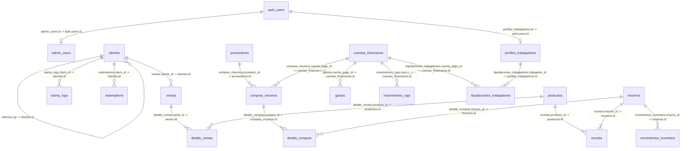

# TITAN GRILL — MODELO DE DATOS Y VALIDACIÓN DE INFRAESTRUCTURA (FASE 0.7)

Este documento es la especificación técnica maestra para el modelo de datos, la estructura relacional de la base de datos y la distribución de la lógica de negocio de Titan Grill, diseñado para convivir con los datos históricos de producción y guiar la siguiente etapa de desarrollo.

---

## 1. Resumen Ejecutivo
La Fase 0.7 valida el estado actual de Supabase LIVE y establece el diseño detallado del modelo de datos para convertir la visión funcional de Titan Grill en una arquitectura de base de datos relacional de producción. 

El modelo propuesto amplía la estructura actual (basada puramente en fidelización) hacia un sistema transaccional robusto donde cada entrada de dinero, salida de insumo, sello de fidelización y obligación laboral de nómina se origina a partir de un **Evento Central (Venta o Compra)**, garantizando la trazabilidad total, la prevención de fraudes y el control en tiempo real del estado financiero y operativo del negocio.

---

## 2. Estado Real de Supabase LIVE
* **Instancia conectada**: `mdeviajob-ui's Project`
* **Ref**: `mbyjehhplruoqlgphfvw`
* **Motor**: PostgreSQL 17.6.1.
* **Esquema activo**: `public`
* **Estado**: RLS habilitado en todas las tablas, pero con dependencias de autorización laxas en el frontend.

---

## 3. Tablas Actuales (Esquema Físico Real)

### 3.1 `clientes`
* `id` (`uuid`, PK, default: `gen_random_uuid()`)
* `nombre` (`text`, nullable)
* `celular` (`text`, unique)
* `email` (`text`, nullable)
* `stamps_count` (`integer`, default: `0`)
* `created_at` (`timestamp with time zone`, default: `timezone('utc'::text, now())`)
* `last_stamp_at` (`timestamp with time zone`, nullable)
* `referral_code` (`text`, unique, nullable)
* `referred_by` (`uuid`, FK -> `clientes.id` con `ON DELETE SET NULL`, nullable)

### 3.2 `admin_users`
* `id` (`uuid`, PK, FK -> `auth.users.id` con `ON DELETE CASCADE`)
* `email` (`text`, unique, nullable)

### 3.3 `stamp_logs`
* `id` (`uuid`, PK, default: `gen_random_uuid()`)
* `client_id` (`uuid`, FK -> `clientes.id`)
* `created_at` (`timestamp with time zone`, default: `now()`)
* `notes` (`text`, nullable)

### 3.4 `redemptions`
* `id` (`uuid`, PK, default: `gen_random_uuid()`)
* `client_id` (`uuid`, FK -> `clientes.id`)
* `stamps_exchanged` (`integer`)
* `redeemed_at` (`timestamp with time zone`, default: `now()`)

### 3.5 `admin_audit_log`
* `id` (`uuid`, PK, default: `gen_random_uuid()`)
* `admin_id` (`uuid`, FK -> `auth.users.id`)
* `action` (`text`)
* `target_client_id` (`uuid`, FK -> `clientes.id`, nullable)
* `details` (`jsonb`, nullable)
* `created_at` (`timestamp with time zone`, default: `now()`)

---

## 4. RPC Actuales (Esquema Físico Real)

1. **`increment_stamps(client_id uuid)`**: Incrementa `stamps_count` en 1 en la fila del cliente e inserta un log en `stamp_logs`. (*Security Definer*).
2. **`redeem_reward(client_id uuid)`**: Bloquea la fila del cliente con `FOR UPDATE`, valida que tenga $\ge 10$ sellos, descuenta 10 sellos, e inserta una fila en `redemptions`. (*Security Definer*).
3. **`get_client_by_referral_code(ref_code text)`**: Retorna el `id` y `nombre` del cliente cuyo código coincida. (*Security Definer*).
4. **`process_referral_bonus(new_client_id uuid)`**: Otorga 1 sello al referidor e inserta un log en `stamp_logs` con formato JSON si es el primer sello del referido. (*Security Definer*, huérfana en triggers).
5. **`trigger_check_referral_bonus()`**: Valida si es el primer sello real del cliente y otorga el bono al referidor. (*Security Definer*, ejecutada por trigger).
6. **`generate_referral_code()`**: Helper que genera y valida un código alfanumérico único de 8 caracteres. (*Security Invoker*).
7. **`trigger_referral_bonus()`**: Wrapper del trigger enhanced. (*Security Invoker*, huérfana).
8. **`validate_referral_code(code text)`**: Valida la expresión regular del código. (*Security Invoker*).

---

## 5. RLS Actuales (Esquema Físico Real)

* **`clientes`**:
  * `Allow public insert` / `Permitir inserción pública`: `INSERT WITH CHECK (true)` (Público).
  * `Permitir lectura pública`: `SELECT USING (true)` (Público).
  * `Allow authenticated read`: `SELECT USING (auth.role() = 'authenticated')`.
  * `Allow authenticated update`: `UPDATE USING (auth.role() = 'authenticated')`.
  * `Permitir actualización a admins`: `UPDATE TO authenticated USING (true)`.
* **`stamp_logs`** / **`redemptions`** / **`admin_audit_log`**:
  * `Admins can view / read-only`: `SELECT USING (auth.role() = 'authenticated')`.
* **`admin_users`**:
  * `Allow own status read`: `SELECT USING (auth.uid() = id)`.

---

## 6. Triggers Actuales (Esquema Físico Real)

1. **`set_referral_code`** on `clientes`: `BEFORE INSERT FOR EACH ROW WHEN (new.referral_code IS NULL) EXECUTE FUNCTION generate_referral_code()`
2. **`trg_check_referral_bonus`** on `stamp_logs`: `AFTER INSERT FOR EACH ROW EXECUTE FUNCTION trigger_check_referral_bonus()`

---

## 7. Problemas Detectados (Análisis de Seguridad y Lógica)

1. 🔴 **Falta de Validación de Rol en Base de Datos**: Las RPCs críticas (`increment_stamps`, `redeem_reward`) son ejecutables por `PUBLIC`. Al ser `SECURITY DEFINER`, corren con privilegios de `postgres` y cualquier usuario anónimo autenticado puede invocarlas saltándose los controles de `/admin` en React.
2. 🔴 **Políticas RLS "Admin" Laxas**: La política `Permitir actualización a admins` de `clientes` permite la actualización a cualquier usuario autenticado (`auth.role() = 'authenticated'`) sin validar si su ID existe en `admin_users`.
3. 🟠 **Funciones y Triggers Huérfanos**: Las funciones `process_referral_bonus`, `trigger_referral_bonus` y el trigger `auto_referral_bonus` existen en LIVE pero no están engranados en el flujo de ejecución real.
4. 🟡 **Falta de Auditoría en Cambios de Base de Datos**: Si un administrador edita directamente una fila de `clientes` usando la tabla de Supabase Studio, no queda registro alguno en `admin_audit_log`.

---

## 8. Entidades Futuras y Modelo Relacional Propuesto

Se propone crear **11 nuevas entidades** para dar soporte a la Fuente de la Verdad, estructuradas de la siguiente manera:

```text
Clientes  ── [Fidelización] 
   │
   ├── [POS/Ventas] ──> ventas ──> detalle_ventas ──> productos (Catálogo)
   │                                                     │
   │                                                 [Recetas]
   │                                                     │
   ├── [Inventario] <── movimientos_inventario <─── recetas
   │                           │
   │                        insumos
   │                           │
   │                       [Compras]
   │                           │
   └── [Caja/Bolsillos] <── compras_insumos ──> proveedores
            │
         movimientos_caja ──> cuentas_financieras (Efectivo, Nequi, etc.)
            │
         gastos (Servicios, etc.)
            │
         liquidaciones_trabajadores ──> perfiles_trabajadores (Trabajadores)
```

---

## 9. Modelo Relacional Propuesto (Especificación de Tablas)

### 9.1 `cuentas_financieras` [NUEVA]
* *Propósito*: Administrar bolsillos de dinero configurables.
* *Columnas*:
  * `id` (`uuid`, PK, default: `gen_random_uuid()`)
  * `nombre` (`text`, unique, not null) - Ej: 'Efectivo Caja', 'Nequi', 'Bancolombia'
  * `saldo_actual` (`numeric(12,2)`, default: `0.00`) - Valor derivado de la suma de movimientos de caja.
  * `activo` (`boolean`, default: `true`)

### 9.2 `productos` [NUEVA]
* *Propósito*: Catálogo comercial del menú.
* *Columnas*:
  * `id` (`uuid`, PK, default: `gen_random_uuid()`)
  * `nombre` (`text`, not null)
  * `descripcion` (`text`, nullable)
  * `categoria` (`text`, not null)
  * `precio_venta` (`numeric(10,2)`, not null)
  * `precio_promocional` (`numeric(10,2)`, nullable)
  * `disponibilidad` (`boolean`, default: `true`)
  * `imagen_url` (`text`, nullable)
  * `activo` (`boolean`, default: `true`) - Reemplaza borrado físico.

### 9.3 `insumos` [NUEVA]
* *Propósito*: Inventario de materias primas e ingredientes.
* *Columnas*:
  * `id` (`uuid`, PK, default: `gen_random_uuid()`)
  * `nombre` (`text`, unique, not null)
  * `stock_actual` (`numeric(10,3)`, default: `0.000`)
  * `stock_minimo` (`numeric(10,3)`, default: `0.000`)
  * `unidad_medida` (`text`, not null) - Ej: 'g', 'ml', 'und'
  * `ultimo_costo` (`numeric(12,2)`, default: `0.00`)
  * `costo_promedio` (`numeric(12,2)`, default: `0.00`)

### 9.4 `recetas` [NUEVA]
* *Propósito*: Estructura de insumos necesarios para preparar un producto.
* *Columnas*:
  * `producto_id` (`uuid`, FK -> `productos.id` ON DELETE CASCADE, PK)
  * `insumo_id` (`uuid`, FK -> `insumos.id` ON DELETE RESTRICT, PK)
  * `cantidad` (`numeric(10,3)`, not null) - Cantidad requerida en la unidad del insumo.

### 9.5 `proveedores` [NUEVA]
* *Propósito*: Registro de proveedores comerciales.
* *Columnas*:
  * `id` (`uuid`, PK, default: `gen_random_uuid()`)
  * `nombre` (`text`, not null)
  * `telefono` (`text`, nullable)
  * `nit` (`text`, nullable)

### 9.6 `ventas` [NUEVA]
* *Propósito*: Registro principal de transacciones comerciales de venta.
* *Columnas*:
  * `id` (`uuid`, PK, default: `gen_random_uuid()`)
  * `cliente_id` (`uuid`, FK -> `clientes.id` ON DELETE SET NULL, nullable) - NULL indica Venta Anónima.
  * `total` (`numeric(12,2)`, not null)
  * `descuento_total` (`numeric(12,2)`, default: `0.00`)
  * `motivo_descuento` (`text`, nullable)
  * `autorizado_por` (`uuid`, FK -> `auth.users.id`, nullable)
  * `creado_por` (`uuid`, FK -> `auth.users.id`, default: `auth.uid()`)
  * `estado` (`text`, default: 'COMPLETADA') - Valores: 'COMPLETADA', 'ANULADA'
  * `created_at` (`timestamp with time zone`, default: `now()`)

### 9.7 `detalle_ventas` [NUEVA]
* *Propósito*: Desglose de productos comprados en cada venta.
* *Columnas*:
  * `id` (`uuid`, PK, default: `gen_random_uuid()`)
  * `venta_id` (`uuid`, FK -> `ventas.id` ON DELETE CASCADE)
  * `producto_id` (`uuid`, FK -> `productos.id` ON DELETE RESTRICT)
  * `cantidad` (`integer`, not null)
  * `precio_unitario` (`numeric(10,2)`, not null) - Histórico al momento de la venta.
  * `descuento_unitario` (`numeric(10,2)`, default: `0.00`)
  * `costo_historico_receta` (`numeric(10,2)`, not null) - Para reportar rentabilidad fija en el tiempo.

### 9.8 `compras_insumos` [NUEVA]
* *Propósito*: Registro de compras de mercadería a proveedores.
* *Columnas*:
  * `id` (`uuid`, PK, default: `gen_random_uuid()`)
  * `proveedor_id` (`uuid`, FK -> `proveedores.id` ON DELETE SET NULL, nullable)
  * `total` (`numeric(12,2)`, not null)
  * `cuenta_pago_id` (`uuid`, FK -> `cuentas_financieras.id`)
  * `creado_por` (`uuid`, FK -> `auth.users.id`, default: `auth.uid()`)
  * `created_at` (`timestamp with time zone`, default: `now()`)

### 9.9 `detalle_compras` [NUEVA]
* *Propósito*: Desglose de insumos adquiridos en una compra.
* *Columnas*:
  * `id` (`uuid`, PK, default: `gen_random_uuid()`)
  * `compra_id` (`uuid`, FK -> `compras_insumos.id` ON DELETE CASCADE)
  * `insumo_id` (`uuid`, FK -> `insumos.id` ON DELETE RESTRICT)
  * `cantidad` (`numeric(10,3)`, not null)
  * `costo_unitario` (`numeric(12,2)`, not null)

### 9.10 `movimientos_inventario` [NUEVA]
* *Propósito*: Registro transaccional (Kardex) de entradas y salidas de stock.
* *Columnas*:
  * `id` (`uuid`, PK, default: `gen_random_uuid()`)
  * `insumo_id` (`uuid`, FK -> `insumos.id` ON DELETE RESTRICT)
  * `tipo` (`text`, not null) - Valores: 'ENTRADA_COMPRA', 'SALIDA_VENTA', 'SALIDA_MERMA', 'SALIDA_VENCIMIENTO', 'AJUSTE_POSITIVO', 'AJUSTE_NEGATIVO', 'REVERSIÓN'
  * `cantidad` (`numeric(10,3)`, not null) - Siempre positivo. El tipo determina la dirección.
  * `costo_historico` (`numeric(12,2)`, not null)
  * `origen_id` (`uuid`) - ID de la venta, compra o merma que causó el movimiento.
  * `creado_por` (`uuid`, FK -> `auth.users.id`, default: `auth.uid()`)
  * `created_at` (`timestamp with time zone`, default: `now()`)

### 9.11 `movimientos_caja` [NUEVA]
* *Propósito*: Bitácora contable de flujos de dinero en las cuentas.
* *Columnas*:
  * `id` (`uuid`, PK, default: `gen_random_uuid()`)
  * `cuenta_id` (`uuid`, FK -> `cuentas_financieras.id` ON DELETE RESTRICT)
  * `tipo` (`text`, not null) - Valores: 'INGRESO_VENTA', 'EGRESO_COMPRA', 'EGRESO_GASTO', 'EGRESO_NOMINA', 'TRANSFERENCIA_EGRESO', 'TRANSFERENCIA_INGRESO', 'AJUSTE'
  * `monto` (`numeric(12,2)`, not null)
  * `origen_id` (`uuid`) - ID de venta, compra, gasto o liquidación.
  * `descripcion` (`text`, nullable)
  * `creado_por` (`uuid`, FK -> `auth.users.id`, default: `auth.uid()`)
  * `created_at` (`timestamp with time zone`, default: `now()`)

### 9.12 `gastos` [NUEVA]
* *Propósito*: Egresos operativos no relacionados con compras de catálogo.
* *Columnas*:
  * `id` (`uuid`, PK, default: `gen_random_uuid()`)
  * `categoria` (`text`, not null) - Ej: 'Servicios', 'Transporte', 'Reparaciones'
  * `monto` (`numeric(12,2)`, not null)
  * `cuenta_pago_id` (`uuid`, FK -> `cuentas_financieras.id`)
  * `descripcion` (`text`, not null)
  * `comprobante_url` (`text`, nullable)
  * `creado_por` (`uuid`, FK -> `auth.users.id`, default: `auth.uid()`)
  * `created_at` (`timestamp with time zone`, default: `now()`)

### 9.13 `perfiles_trabajadores` [NUEVA]
* *Propósito*: Configuración laboral e identidades del staff operativo.
* *Columnas*:
  * `id` (`uuid`, PK, FK -> `auth.users.id` ON DELETE CASCADE)
  * `nombre` (`text`, not null)
  * `rol` (`text`, not null) - Valores: 'ADMINISTRADOR', 'TRABAJADOR'
  * `modalidad_pago` (`text`, not null) - Valores: 'POR_HORA', 'POR_VENTA', 'POR_TURNO'
  * `tarifa` (`numeric(10,2)`, default: `0.00`)
  * `comision_porcentaje` (`numeric(5,2)`, default: `0.00`) - Si aplica por venta.
  * `activo` (`boolean`, default: `true`)

### 9.14 `liquidaciones_trabajadores` [NUEVA]
* *Propósito*: Registro de nómina y pagos realizados a trabajadores.
* *Columnas*:
  * `id` (`uuid`, PK, default: `gen_random_uuid()`)
  * `trabajador_id` (`uuid`, FK -> `perfiles_trabajadores.id` ON DELETE RESTRICT)
  * `periodo_inicio` (`date`, not null)
  * `periodo_fin` (`date`, not null)
  * `monto_generado` (`numeric(12,2)`, not null)
  * `monto_pagado` (`numeric(12,2)`, default: `0.00`)
  * `cuenta_pago_id` (`uuid`, FK -> `cuentas_financieras.id`, nullable)
  * `estado` (`text`, default: 'PENDIENTE') - Valores: 'PENDIENTE', 'PAGADO'
  * `pagado_at` (`timestamp with time zone`, nullable)

---

## 10. Diagrama de Relaciones (ERD Mermaid)



---

## 11. Flujos de Datos Transaccionales

### 11.1 Flujo de Venta
1. El POS crea un registro en `ventas` con el `cliente_id` (opcional) y el total.
2. Por cada producto vendido, inserta en `detalle_ventas` almacenando el `precio_unitario` y `costo_historico_receta` vigentes.
3. Se registran tantos `movimientos_caja` como métodos de pago se usen (tipo: `INGRESO_VENTA` apuntando a las `cuentas_financieras` correspondientes). El total de los movimientos de caja debe igualar al total de la venta.
4. Para cada ingrediente del producto definido en `recetas`, el sistema inserta una fila en `movimientos_inventario` (tipo: `SALIDA_VENTA`, cantidad calculada, costo histórico cargado del costo promedio del insumo) y decrementa `stock_actual` en la tabla `insumos`.
5. Si el cliente está identificado, se gatilla la lógica de Fidelización.
6. Se registra el log de auditoría.

### 11.2 Flujo de Compra
1. El administrador registra la transacción en `compras_insumos` indicando el proveedor y la cuenta de cobro.
2. Se inserta el detalle en `detalle_compras` para cada ingrediente especificando la cantidad y el costo unitario de adquisición.
3. El sistema inserta filas en `movimientos_inventario` (tipo: `ENTRADA_COMPRA`), sumando el stock en `insumos`.
4. Se recalcula el `costo_promedio` and `ultimo_costo` del insumo.
5. Se inserta un `movimientos_caja` (tipo: `EGRESO_COMPRA`) restando fondos de la cuenta seleccionada.

### 11.3 Flujo de Merma
1. El administrador declara la pérdida de un insumo.
2. Se inserta una fila en `movimientos_inventario` (tipo: `SALIDA_MERMA` o `SALIDA_VENCIMIENTO`, cantidad, costo histórico tomado del costo promedio actual) vinculando el motivo del descarte.
3. Se decrementa `stock_actual` en `insumos`.
4. No genera ningún movimiento de caja (puesto que el dinero ya salió en la compra), pero el sistema registra la pérdida monetaria en los cálculos de rentabilidad.

### 11.4 Flujo de Devolución
1. El administrador solicita la devolución parcial o total de una venta.
2. Se anula la venta cambiando su estado a 'ANULADA' (o creando un registro espejo negativo).
3. Se inserta un `movimientos_caja` negativo para contrarrestar el cobro original.
4. El stock de insumos se reintegra creando un `movimientos_inventario` de tipo `REVERSIÓN`.
5. Si se otorgaron sellos de fidelización por esa venta, se decrementan del contador del cliente.

### 11.5 Flujo de Transferencia entre Cuentas
1. Se crea un movimiento financiero de tipo `TRANSFERENCIA_EGRESO` restando el monto de la Cuenta A.
2. Se crea un movimiento de tipo `TRANSFERENCIA_INGRESO` sumando el monto en la Cuenta B.
3. Ambos movimientos comparten el mismo ID de origen o referencia. El sistema consolida los saldos netos sin alterar las métricas de ingresos comerciales por ventas.

---

## 12. Modelo de Costos (Estándar vs Real)

### Método de Valoración de Inventario recomendado: Costo Promedio Ponderado (CPP)
Se descarta *Último Costo* porque distorsiona el margen en periodos de inflación volátil, y *FIFO* porque agrega una complejidad excesiva de control de lotes innecesaria para un restaurante de comidas rápidas de este tamaño. El CPP ofrece un equilibrio perfecto entre precisión financiera y facilidad de cálculo.

* **Fórmula de Recálculo del CPP (en cada Compra)**:

$$\text{Nuevo Costo Promedio} = \frac{(\text{Stock Actual} \times \text{Costo Promedio Actual}) + (\text{Cantidad Comprada} \times \text{Costo Unitario de Compra})}{\text{Stock Actual} + \text{Cantidad Comprada}}$$

### Estructura de Recetas
* **Costo Estándar de Receta**: Se calcula sumando el costo promedio vigente de cada ingrediente multiplicado por su cantidad requerida.
* **Precio Sugerido**: Se calcula aplicando una regla de margen objetivo sobre el costo (ej: Costo / 0.35 para un margen de costo de alimentos del 35%).

---

## 13. Modelo de Inventario
* El stock teórico vive en la columna `stock_actual` de la tabla `insumos`, pero su **fuente de la verdad** es el acumulado histórico de `movimientos_inventario`.
* Los arqueos físicos periódicos registran la cantidad real. Si hay discrepancia, se ingresa un ajuste de inventario (`AJUSTE_POSITIVO` o `AJUSTE_NEGATIVO`) con su respectiva bitácora de auditoría detallando el porqué (merma no reportada, robo, etc.).

---

## 14. Modelo de Ventas y POS
* La interfaz del POS manejará un estado de venta local. Al presionar "Cerrar Venta", se dispara una transacción SQL atómica que afecta Ventas, Caja e Inventario.
* Múltiples medios de pago se registran mapeando n filas de la tabla `movimientos_caja` a una sola `venta_id`.

---

## 15. Modelo Financiero y Reportes
* **Utilidad Bruta**: Sumatoria de `total` en `ventas` menos sumatoria de `costo_historico_receta` en `detalle_ventas` para las ventas en estado 'COMPLETADA'.
* **Utilidad Neta**: Utilidad Bruta menos `monto` de la tabla `gastos` y `monto_pagado` de `liquidaciones_trabajadores`.
* El saldo real de cada bolsillo de dinero en `cuentas_financieras` se verifica sumando algebraicamente sus movimientos en `movimientos_caja`.

---

## 16. Modelo de Trabajadores
* Los trabajadores se registran en `perfiles_trabajadores`.
* Las liquidaciones calculan de forma programada los turnos o comisiones:
  * `POR_HORA` / `POR_TURNO`: Multiplica la tarifa configurada por la cantidad de bloques declarados.
  * `POR_VENTA`: Suma las ventas asociadas a su identificador de usuario creador (`creado_por` en `ventas`) durante el rango de fechas de la liquidación, aplicando el porcentaje establecido.
* Al pagarse la nómina, se genera el registro en `liquidaciones_trabajadores` y se extrae el dinero de caja mediante `movimientos_caja`.

---

## 17. Modelo de Fidelización
* **Regla Estricta**: `1 Venta Elegible = 1 Sello`. Se inserta un log en `stamp_logs` con `notes = 'Sello automático por Venta ID: [UUID]'`.
* **Sello Especial (Manual)**: El administrador puede otorgar sellos directamente. Requiere un tipo específico en `notes` (ej: `{"type": "manual", "reason": "Cortesía", "approved_by": "[ID]"}`) para diferenciarlo de los sellos comerciales.
* **Referidos**: Cuando el Cliente B (referido) completa su primera venta registrada, el sistema otorga 1 sello de bono al Cliente A (referidor) guardando la FK de la venta de B como justificación, garantizando trazabilidad física.

---

## 18. Modelo de Auditoría
* Cualquier acción sensible gatilla un insert en `admin_audit_log`.
* Para modificaciones de ventas cerradas:
  * El trabajador solicita el cambio.
  * Se genera una entrada en estado 'PENDIENTE' en `admin_audit_log`.
  * El administrador aprueba el cambio, lo que ejecuta el ajuste en la base de datos y cambia el estado del log a 'APROBADO', guardando la diferencia en un campo JSONB (`{"antes": {...}, "despues": {...}}`).

---

## 19. Estrategia de Migración Futura

Para no romper el sitio web actual ni la base de datos de producción:

1. **Fase 1: Creación de tablas auxiliares**: Crear las tablas de `cuentas_financieras`, `insumos`, `productos` y `recetas` sin alterar nada de fidelización.
2. **Fase 2: Poblar catálogo inicial**: Migrar el menú estático del frontend de React a la tabla de `productos` en Supabase.
3. **Fase 3: Vinculación de Sellos**: Modificar `stamp_logs` para añadir la columna `venta_id` (FK nullable) para soportar la nueva regla de ligadura.
4. **Fase 4: Migración de Clientes**: Las columnas existentes en `clientes` se conservan idénticas. No requiere cambios de estructura para asegurar compatibilidad total con la App actual.

---

## 20. Distribución de Lógica de Negocio (PostgreSQL vs Edge Functions vs Frontend)

| Operación | Dónde se ejecuta | Razón / Ventaja |
|---|---|---|
| **Registrar Venta** | **PostgreSQL (Transacción / RPC)** | Garantiza atomicidad: si falla el descuento de stock de algún ingrediente o el registro de caja, la venta completa hace rollback. |
| **Procesar Pago** | **PostgreSQL (RPC)** | Consistencia inmediata en las cuentas financieras. |
| **Generar Sello** | **PostgreSQL (Trigger)** | Despliegue automático y seguro al cambiar el estado de la venta a 'COMPLETADA'. |
| **Bono de Referido** | **PostgreSQL (Trigger)** | Seguridad de base de datos para validar si es el primer sello real. |
| **Cancelar Venta** | **PostgreSQL (RPC)** | Manejo de reversión atómica de stock, caja y sellos. |
| **Cálculo de Nómina** | **Supabase Edge Function** | Lógica de cálculo compleja de comisiones/fechas y automatización de reportes mensuales. |
| **Atención por WhatsApp** | **n8n + Evolution API** | Integración externa de canales de mensajería sin sobrecargar la base de datos. |

---

## 21. Índices Propuestos para Escalabilidad (No creados)

1. `CREATE INDEX idx_ventas_created_at ON public.ventas (created_at DESC);` - Optimiza consultas de reportes por fecha.
2. `CREATE INDEX idx_ventas_cliente_id ON public.ventas (cliente_id);` - Agiliza búsquedas del historial de un cliente.
3. `CREATE INDEX idx_movimientos_caja_cuenta_id ON public.movimientos_caja (cuenta_id);` - Optimiza el cálculo de saldos por bolsillo.
4. `CREATE INDEX idx_movimientos_inventario_insumo_id ON public.movimientos_inventario (insumo_id);` - Optimiza reportes de stock.

---

## 22. Compatibilidad con el Sistema Actual
* **Clientes existentes**: Se conservan al 100%. Sus campos `stamps_count`, `referral_code` y `referred_by` siguen siendo leídos por el frontend actual sin cambios.
* **Historial de Sellos**: Los registros de `stamp_logs` existentes tendrán la columna `venta_id` como `NULL`, lo cual la aplicación actual interpreta como "sellos históricos/migrados", manteniendo la compatibilidad retroactiva absoluta.

---

## 23. Decisiones Pendientes del Propietario

> [!IMPORTANT]
> **🔴 DECISIONES BLOQUEANTES**
> 1. **Esquema de Liquidaciones**: ¿Se aprueba limitar las modalidades de pago de trabajadores únicamente a "Pago Fijo", "Por Hora", "Por Turno" o "Porcentaje sobre Ventas", descartando esquemas mixtos complejos en la fase inicial?
> 2. **Nivel de Permisos de Administradores**: ¿Los 3 administradores actuales tendrán el mismo nivel de acceso root sobre finanzas y borrado de registros, o existirá un rol "Propietario" único superior?

> [!TIP]
> **🟠 DECISIONES IMPORTANTES**
> 3. **Método de Costeo**: ¿Se aprueba la estrategia de Costo Promedio Ponderado (CPP) para el cálculo de costos y rentabilidad de recetas estándar?
> 4. **Arqueo de Caja**: ¿El arqueo diario se hará "a ciegas" para el cajero (el sistema no muestra el valor teórico esperado en la pantalla de cierre) para garantizar mayor honestidad en el conteo de efectivo?

---

## 24. Recomendación del Siguiente Paso
Una vez aprobada esta especificación conceptual, el siguiente paso recomendado es la **Fase 1: Configuración de Seguridad y Roles**, donde crearemos la tabla de `perfiles_trabajadores`, definiremos las políticas RLS definitivas basadas en `auth.uid() = id`, y blindaremos las funciones RPC críticas restringiendo el acceso `PUBLIC`.
