# TITAN GRILL — MODELO DE DATOS FASE 0.8
# VALIDACION, SIMULACION Y PRUEBA DE CONSISTENCIA
# READ-ONLY — NO IMPLEMENTAR

---

## 1. RESUMEN EJECUTIVO

Este documento somete el modelo de datos de la **Fase 0.7** (`TITAN_GRILL_MODELO_DATOS_FASE_0_7.md`) a una revision critica exhaustiva que simula operaciones reales de Titan Grill.

**Postura adoptada**: No se asume que el modelo 0.7 es correcto. El objetivo es demostrar donde puede romperse bajo presion operacional real.

**Resultado general**: El modelo 0.7 es una base solida pero **REQUIERE CAMBIOS** antes de implementarse.

| Severidad | Cantidad |
|-----------|----------|
| Criticos bloqueantes | 9 |
| Importantes (degradan integridad) | 11 |
| Menores (afectan experiencia o reportes) | 8 |
| Soportados correctamente | 22 |

---

## 2. EVALUACION DEL MODELO 0.7

### Estado: **REQUIERE CAMBIOS**

Problemas estructurales detectados:

1. **No existe tabla pagos_venta** - los medios de pago van directo a movimientos_caja, eliminando la capacidad de reconciliar pagos con ventas.
2. **No existe entidad de anulaciones/devoluciones estructurada** - el modelo usa cambio de estado pero no registra quien, cuando, por que, ni los datos anteriores.
3. **El sello de fidelizacion no tiene tipo** - no es posible diferenciar entre sello por venta, sello por referido y sello manual en stamp_logs.
4. **No hay control de idempotencia** - una doble solicitud de venta puede crear 2 ventas duplicadas.
5. **No hay tabla de roles_permisos** - el campo rol en perfiles_trabajadores es texto libre sin permisos granulares.
6. **No existe snapshot de receta historico** - si cambia la receta, el costo_historico_receta en detalle_ventas queda huerfano sin explicacion.
7. **No existe turnos_trabajadores** - no es posible calcular nomina por hora/turno sin registrar las horas trabajadas.
8. **Devolucion parcial por item no esta soportada** - no hay entidad devoluciones_detalle.
9. **saldo_actual en cuentas_financieras es redundante y peligroso** - es campo derivado almacenado de forma desnormalizada.

---

## 3. RESULTADOS DE SIMULACIONES

### PRUEBA 3 - CICLO COMPLETO DE VENTA: FALLA PARCIAL

**Escenario**: Cliente compra hamburguesa + salchipapa + bebida = 35.000 pesos.
Paga 20.000 efectivo + 15.000 Nequi.

**Entidades que intervienen:**
- ventas (1 fila: cliente_id, total: 35000)
- detalle_ventas (3 filas: precio_unitario y costo_historico_receta)
- movimientos_caja (2 filas: efectivo 20000, nequi 15000)
- movimientos_inventario (salidas por ingredientes de los 3 productos)
- stamp_logs (1 sello)
- admin_audit_log

**PROBLEMA CRITICO**: No existe tabla pagos_venta. Los 20.000 y 15.000 van directamente a movimientos_caja sin tabla intermedia.
- No se puede responder: Cuanto de esta venta fue pagado con Nequi?
- Si se anula la venta, no se sabe cuanto devolver por cada metodo de pago

**PROBLEMA**: stamp_logs no tiene campo tipo. No se puede identificar el origen del sello.

---

### PRUEBA 4 - VENTA SIN CLIENTE: PASA

ventas.cliente_id = NULL soportado. No se inserta en stamp_logs. Correcto.

---

### PRUEBA 5 - VENTA CON UN SOLO PAGO: PASA

1 fila en movimientos_caja tipo INGRESO_VENTA. No hay movimientos ficticios. (Con advertencia de falta de tabla pagos_venta)

---

### PRUEBA 6 - PAGO MIXTO: FALLA PARCIAL

**Pago normal**: 3 filas en movimientos_caja, suma = 50.000. Correcto.

**PROBLEMAS CRITICOS en casos anomalos**:
- Si pagos suman MENOS: el modelo 0.7 no tiene validacion de SUM(pagos) = ventas.total
- Si pagos suman MAS: sistema acepta sobrepago sin registrarlo como vuelto
- Si un pago se cancela: no existe mecanismo de cancelacion de pago individual

**Datos faltantes**:
- Tabla pagos_venta (venta_id, cuenta_id, monto, estado)
- Constraint que valide SUM(pagos_venta.monto) = ventas.total
- Concepto de vuelto/cambio para efectivo

---

### PRUEBA 7 - DESCUENTO: PASA CON ADVERTENCIAS

ventas.descuento_total y detalle_ventas.descuento_unitario soportados.
Advertencia: no hay campo tipo_descuento (porcentual vs fijo).

---

### PRUEBA 8 - FIDELIZACION (1 VENTA = 1 SELLO): FALLA

stamp_logs no tiene campo tipo ni venta_id FK.
El modelo 0.7 propone guardar en notes un JSON pero es texto libre sin estructura garantizada. No hay FK real, no hay constraint, no hay indice eficiente.

**Datos faltantes en stamp_logs**:
- tipo (ENUM: VENTA, REFERIDO, MANUAL, PROMOCIONAL)
- venta_id (FK nullable a ventas)
- otorgado_por (FK a auth.users)

---

### PRUEBA 9 - VENTA SIN FIDELIZACION: PASA CON ADVERTENCIA

No hay campo explicito en ventas para indicar "cliente opto por no participar en fidelizacion".
Puede confundirse con "el trabajador olvido asignar el sello".
Recomendacion: Anadir ventas.fidelizacion_aplicada (boolean, default false).

---

### PRUEBA 10 - SELLO ESPECIAL MANUAL: FALLA

stamp_logs no tiene campo tipo ni otorgado_por ni venta_id.
No hay forma de hacer WHERE tipo = MANUAL de forma confiable con indice.

---

### PRUEBA 11 - REFERIDO: FALLA PARCIAL

**Problemas con el flujo futuro**:
- Si el sello de B ahora viene de una venta (no de stamp_logs directamente), el trigger necesita actualizarse
- Si B cancela la venta despues de que A ya recibio el bono: el modelo 0.7 no define la reversion del bono
- No hay tabla referidos que registre explicitamente la relacion y estado del bono

**Datos faltantes**:
- Tabla referidos: referidor_id, referido_id, venta_activadora_id, sello_otorgado_at, estado (PENDIENTE, ACTIVADO, REVERTIDO)

---

### PRUEBA 12 - CANCELACION DE VENTA: FALLA

**Problemas detectados**:
- No hay tabla anulaciones_ventas que registre: quien anulo, cuando, por que, que usuario autorizo
- Si hay multiples metodos de pago, no hay registro de que cuenta recibe la devolucion de cada parte
- No hay estado intermedio: la venta pasa de COMPLETADA a ANULADA sin proceso formal
- Si se borra la fila de stamp_logs se pierde historial. Si se mantiene, el contador y los logs quedan inconsistentes.

**Datos faltantes**:
- Tabla anulaciones_ventas (venta_id, motivo, autorizado_por, created_at)
- Estado adicional en ventas: PENDIENTE_ANULACION
- stamp_logs necesita estado (ACTIVO, REVERTIDO) en lugar de borrado fisico

---

### PRUEBA 13 - DEVOLUCION PARCIAL: FALLA CRITICA

El modelo 0.7 NO tiene soporte para devolucion parcial por item.
El flujo anula la venta completa. No existe devoluciones_detalle.

**Datos faltantes**:
- Tabla devoluciones (venta_id, tipo: TOTAL/PARCIAL, motivo, autorizado_por, created_at)
- Tabla devoluciones_detalle (devolucion_id, detalle_venta_id, cantidad_devuelta, monto_reembolsado, cuenta_reembolso_id)
- Estados adicionales en ventas: DEVUELTA_PARCIAL, DEVUELTA_TOTAL

---

### PRUEBA 14 - MODIFICACION DE VENTA CERRADA: FALLA PARCIAL

admin_audit_log no tiene campos de estado (PENDIENTE, APROBADO, RECHAZADO) ni campo delta estructurado.

**Mecanismo mas seguro recomendado**:
1. Trabajador solicita cambio -> se crea registro en solicitudes_modificacion_venta
2. El sistema NO modifica la venta directamente
3. Administrador aprueba -> sistema aplica ajuste y registra delta
4. La venta original NUNCA se borra — se crea ajuste compensatorio

---

### PRUEBA 15 - COMPRA DE INSUMOS: PASA CON ADVERTENCIAS

Flujo correcto en modelo 0.7 (compras_insumos, detalle_compras, movimientos_inventario, CPP, movimientos_caja).

Advertencias:
- El recalculo del CPP no define si es trigger, RPC o calculo manual
- No hay campo numero_factura en compras_insumos

---

### PRUEBA 16 - CAMBIO DE COSTO: PASA CON ADVERTENCIA

CPP absorbe el cambio. Ventas historicas conservan costo_historico_receta.
Advertencia: No hay historial de cambios de costo de insumo. No se puede auditar "Cuando cambio el precio del queso?"

---

### PRUEBA 17 - RECETA: PASA FINANCIERAMENTE, FALLA AUDITABILIDAD

La tabla recetas soporta la estructura. El costo_historico_receta captura el monto al momento de la venta.

PROBLEMA: Si se modifica la receta, el costo_historico_receta ya guardado no explica POR QUE era ese monto. No hay versioning de recetas.

Ejemplo costo Hamburguesa Especial:
- Pan 80g a 16 pesos/g = 1.280
- Carne 150g a 35 pesos/g = 5.250
- Queso 30g a 20 pesos/g = 600
- Salsa 20g a 5 pesos/g = 100
- Vegetales 50g a 8 pesos/g = 400
- Total costo receta = 7.630

---

### PRUEBA 18 - MERMA: PASA CON ADVERTENCIA

movimientos_inventario tipo SALIDA_MERMA soportado. Stock se decrementa. No genera movimientos_caja.
Advertencia: Falta campo motivo_merma estructurado.

---

### PRUEBA 19 - VENCIMIENTO: PASA PARCIALMENTE

Tipo SALIDA_VENCIMIENTO existe. Pero no hay campo fecha_vencimiento ni lote en insumos.

Recomendacion tecnica: Para restaurante de comida rapida, control de lotes completo es excesivo.
PENDIENTE DE APROBACION DEL PROPIETARIO: Se requiere control de lotes/fechas de vencimiento?

---

### PRUEBA 20 - INVENTARIO (TRAZABILIDAD COMPLETA): PASA

- Cuanto queso hay ahora? -> insumos.stock_actual OK
- Cuanto compramos? -> SUM(movimientos_inventario WHERE tipo=ENTRADA_COMPRA) OK
- Cuanto consumimos? -> SUM WHERE tipo=SALIDA_VENTA OK
- Cuanto se perdio? -> SUM WHERE tipo IN (SALIDA_MERMA, SALIDA_VENCIMIENTO) OK
- Cuanto costo? -> SUM(cantidad x costo_historico WHERE tipo=ENTRADA_COMPRA) OK
- Por que cambio? -> tipo + origen_id OK

---

### PRUEBA 21 - ALERTA DE STOCK: PASA PARCIALMENTE

stock_actual y stock_minimo existen. Falta: stock_critico y punto_reposicion.

---

### PRUEBA 22 - TRANSFERENCIA DE DINERO: FALLA PARCIALMENTE

PROBLEMA: No hay tabla transferencias_cuentas que sea la entidad raiz.
Si el egreso se inserta pero el ingreso falla -> patrimonio inconsistente. Ambos inserts deben ser atomicos.

Dato faltante: Tabla transferencias_cuentas (id, cuenta_origen_id, cuenta_destino_id, monto, descripcion, created_at).

---

### PRUEBA 23 - NUEVA CUENTA FINANCIERA: PASA

cuentas_financieras es configurable. Solo un INSERT. No requiere cambio de esquema.

---

### PRUEBA 24 - GASTO NO INVENTARIABLE: PASA

Tabla gastos existe. No afecta inventario. Genera movimientos_caja tipo EGRESO_GASTO.

---

### PRUEBA 25 - TRABAJADOR: FALLA PARCIAL

perfiles_trabajadores soporta identidad, rol, modalidad_pago, tarifa.

PROBLEMA CRITICO: No existe turnos_trabajadores. Sin esta tabla, no es posible calcular nomina POR_HORA o POR_TURNO automaticamente.

---

### PRUEBA 26 - ADMINISTRADOR VENDE: PASA TECNICAMENTE CON ADVERTENCIA

ventas.creado_por = auth.uid() funciona para admins y trabajadores.

Advertencia: Un admin puede existir en admin_users pero NO en perfiles_trabajadores, y sus ventas no apareceran en reportes de productividad.

Decision requerida: Los administradores tienen perfil_trabajador ademas de su entrada en admin_users?

---

### PRUEBA 27 - ROLES VS PERMISOS: RECOMENDACION TECNICA

El modelo de Roles Simples (ADMINISTRADOR/TRABAJADOR) es SUFICIENTE para la fase inicial.

| Permiso | Trabajador | Administrador |
|---------|-----------|---------------|
| Registrar venta | SI | SI |
| Modificar precio producto | NO | SI |
| Ver estados financieros | NO | SI |
| Eliminar/anular movimientos | NO | SI |
| Otorgar sello manual | NO | SI |
| Registrar compra | NO | SI |
| Consultar historial ventas | SI | SI |

Recomendacion: Fase 1 con 2 roles. RBAC completo en fases futuras.

---

### PRUEBA 28 - ARQUEO DE CAJA: ANALISIS COMPLETO

| Criterio | Directo | A ciegas |
|---------|---------|---------|
| Seguridad anti-fraude | Baja | Alta |
| Facilidad operativa | Alta | Media |
| Riesgo de sesgo | Alto | Bajo |

Recomendacion tecnica: A ciegas para efectivo, Directo para cuentas digitales.
PENDIENTE DE APROBACION DEL PROPIETARIO.

El modelo 0.7 no incluye tabla arqueos_caja -- debe agregarse.

---

### PRUEBA 29 - CONCURRENCIA: REQUIERE DISENO EXPLICITO

Escenario critico: 2 ventas simultaneas con stock de pan = 1.

Sin control:
- Venta A lee stock_actual = 1 -> procede
- Venta B lee stock_actual = 1 -> procede (concurrent read)
- Venta A descuenta -> stock_actual = 0
- Venta B descuenta -> stock_actual = -1 STOCK NEGATIVO

PROBLEMA CRITICO: El modelo 0.7 no especifica el mecanismo de lock para el descuento de inventario.

Solucion requerida: UPDATE insumos SET stock_actual = stock_actual - cantidad WHERE id = insumo_id AND stock_actual >= cantidad_requerida. Si UPDATE afecta 0 filas: ROLLBACK.

| Escenario | Riesgo | Solucion |
|-----------|--------|---------|
| 2 ventas al mismo stock | Stock negativo | FOR UPDATE en insumos |
| 2 personas registrando caja | Doble contabilidad | Transaccion atomica |
| 2 personas modificando venta | Conflicto datos | FOR UPDATE en venta |
| 2 sellos al mismo cliente | stamps_count incorrecto | UPDATE RETURNING atomico (ya existe) |
| 2 transferencias simultaneas | Saldo inconsistente | Transaccion atomica con tabla raiz |

---

### PRUEBA 30 - IDEMPOTENCIA: FALLA

El modelo 0.7 NO tiene mecanismo de idempotencia.
Si el RPC de venta se llama dos veces, se crean 2 ventas identicas con diferentes UUIDs.

Estrategia recomendada:
- El frontend genera UUID unico de solicitud antes de enviar (idempotency_key)
- ventas.idempotency_key (uuid, unique) garantiza que la segunda solicitud falle con error de constraint unico
- El frontend detecta el error y muestra la venta original

---

### PRUEBA 31 - HISTORICOS: FALLA PARCIAL

| Entidad | Dato que cambia | Protegido? | Mecanismo |
|---------|----------------|-----------|---------|
| Precio producto | productos.precio_venta | SI | detalle_ventas.precio_unitario es snapshot |
| Costo insumo | insumos.costo_promedio | SI | movimientos_inventario.costo_historico |
| Receta | recetas.cantidad | NO | No hay versionado de recetas |
| Nombre producto | productos.nombre | PARCIAL | detalle_ventas solo guarda producto_id |
| Comision trabajador | perfiles_trabajadores.comision_porcentaje | NO | No hay historial de cambios |

Datos faltantes:
- detalle_ventas.nombre_producto_snapshot
- Versionado de recetas o snapshot de ingredientes por venta
- historial_tarifas_trabajador: trabajador_id, tarifa_anterior, tarifa_nueva, vigente_desde

---

### PRUEBA 32 - ESTADOS: FALLA PARCIAL

| Entidad | Estados necesarios | Modelo 0.7? |
|---------|--------------------|-------------|
| ventas | COMPLETADA, ANULADA, DEVUELTA_PARCIAL, DEVUELTA_TOTAL, PENDIENTE_ANULACION | Solo 2 |
| productos | ACTIVO, INACTIVO | SI (activo boolean) |
| insumos | ACTIVO, AGOTADO, DESCONTINUADO | Solo stock_actual |
| compras_insumos | PENDIENTE, RECIBIDA, CANCELADA | NO |
| liquidaciones_trabajadores | PENDIENTE, PAGADO | SI |
| stamp_logs | ACTIVO, REVERTIDO | NO |

---

### PRUEBA 33 - INTEGRIDAD FINANCIERA: PASA CON CORRECCION CRITICA

El sistema puede responder todas las preguntas financieras requeridas.

PROBLEMA CRITICO: saldo_actual en cuentas_financieras puede divergir del saldo real calculado desde movimientos_caja.
Recomendacion: Eliminar saldo_actual. El saldo siempre se calcula en tiempo real desde movimientos_caja.

---

### PRUEBA 34 - ESTADOS FINANCIEROS FUTUROS: PASA

El modelo permite construir Estado de Resultados completo. Balance General es futuro.

---

### PRUEBA 35 - PUNTO DE EQUILIBRIO: PASA

Todos los datos necesarios (costos variables, costos fijos, precio, volumen) estan en el modelo.

---

### PRUEBA 36 - ANALISIS PARETO: PASA

Ventas por producto, margen, ranking -- todo calculable desde detalle_ventas.

---

### PRUEBA 37 - PRONOSTICO DE DEMANDA: PASA

Ventas por dia/hora/producto/cantidad desde ventas.created_at y detalle_ventas.

---

### PRUEBA 38 - CEP (CONTROL ESTADISTICO): PASA PARCIALMENTE

La base esta presente. Extensiones futuras posibles sin redisenar el esquema.

---

### PRUEBA 39 - EXPERIENCIA OPERATIVA POS: ANALISIS COMPLETO

| Aspecto modelo | Implicacion UI |
|----------------|----------------|
| Pagos multiples en tabla separada | POS necesita UI para anadir medios de pago dinamicamente |
| cliente_id nullable | POS debe funcionar SIN buscar cliente |
| detalle_ventas por item | POS construye carrito antes de confirmar |
| Transaccion atomica | Boton Cerrar venta dispara todo de una vez |
| Rol del usuario | POS debe mostrar/ocultar funciones segun rol |
| Concurrencia | 2 dispositivos pueden dejar stock negativo sin locks |

Consecuencias criticas para UI:
- Si la transaccion tarda mas de 2 segundos, la UI debe mostrar loading claro para evitar doble-click
- Busqueda de cliente debe ser rapida -- necesita indice en clientes.celular

---

### PRUEBA 40 - COMPATIBILIDAD CON FIDELIZACION EXISTENTE: COMPATIBLE CON PLAN

- clientes: se conserva sin cambios 100%
- stamp_logs: necesita nuevos campos (tipo, venta_id, otorgado_por) -- nullable para retrocompatibilidad
- redemptions: necesita campo autorizado_por
- increment_stamps RPC: debe restringirse de PUBLIC a authenticated+admin
- redeem_reward RPC: misma vulnerabilidad

Los sellos historicos con venta_id = NULL siguen siendo validos.

---

### PRUEBA 41 - SEGURIDAD: ANALISIS COMPLETO

| Operacion | Donde ejecutarse | Razon |
|-----------|-----------------|-------|
| Registrar venta completa | RPC PostgreSQL | Atomicidad inventario + caja + sello |
| Consultar productos | Frontend | Solo lectura |
| Buscar cliente | Frontend | Solo lectura publica por RLS |
| Incrementar sello | RPC PostgreSQL | Actualmente PUBLIC -- debe restringirse |
| Canjear recompensa | RPC PostgreSQL | Usa FOR UPDATE |
| Calcular nomina | Edge Function | Logica compleja |
| Anular venta | RPC PostgreSQL | Reversion atomica |
| Arqueo de caja | RPC PostgreSQL | Comparacion y registro atomico |
| Transferencia entre cuentas | RPC PostgreSQL | 2 movimientos deben ser atomicos |
| Crear producto/insumo | Frontend + RLS | Solo admins |

---

## 4. MODELO 0.8 CORREGIDO

### CAMBIO 1 -- NUEVA TABLA: pagos_venta

Problema: Los pagos van directamente a movimientos_caja sin tabla intermedia.

```sql
CREATE TABLE pagos_venta (
  id          uuid PRIMARY KEY DEFAULT gen_random_uuid(),
  venta_id    uuid NOT NULL REFERENCES ventas(id) ON DELETE CASCADE,
  cuenta_id   uuid NOT NULL REFERENCES cuentas_financieras(id),
  monto       numeric(12,2) NOT NULL,
  estado      text NOT NULL DEFAULT 'COMPLETADO',
  created_at  timestamptz DEFAULT now()
);
```

---

### CAMBIO 2 -- MODIFICACION: stamp_logs (anadir columnas)

Problema: No hay diferenciacion estructural entre sellos por venta, referido o manual.

```sql
ALTER TABLE stamp_logs
  ADD COLUMN tipo         text NOT NULL DEFAULT 'VENTA',
  ADD COLUMN venta_id     uuid REFERENCES ventas(id) ON DELETE SET NULL,
  ADD COLUMN otorgado_por uuid REFERENCES auth.users(id),
  ADD COLUMN estado       text NOT NULL DEFAULT 'ACTIVO',
  ADD COLUMN motivo       text;
```

---

### CAMBIO 3 -- NUEVAS TABLAS: devoluciones y devoluciones_detalle

Problema: No existe entidad para registrar devoluciones parciales con auditoria.

```sql
CREATE TABLE devoluciones (
  id             uuid PRIMARY KEY DEFAULT gen_random_uuid(),
  venta_id       uuid NOT NULL REFERENCES ventas(id) ON DELETE RESTRICT,
  tipo           text NOT NULL,
  motivo         text NOT NULL,
  autorizado_por uuid REFERENCES auth.users(id),
  created_at     timestamptz DEFAULT now()
);

CREATE TABLE devoluciones_detalle (
  id                  uuid PRIMARY KEY DEFAULT gen_random_uuid(),
  devolucion_id       uuid NOT NULL REFERENCES devoluciones(id) ON DELETE CASCADE,
  detalle_venta_id    uuid NOT NULL REFERENCES detalle_ventas(id) ON DELETE RESTRICT,
  cantidad_devuelta   integer NOT NULL,
  monto_reembolsado   numeric(12,2) NOT NULL,
  cuenta_reembolso_id uuid REFERENCES cuentas_financieras(id)
);
```

---

### CAMBIO 4 -- NUEVA TABLA: anulaciones_ventas

Problema: La anulacion de una venta no deja registro de auditoria estructurado.

```sql
CREATE TABLE anulaciones_ventas (
  id             uuid PRIMARY KEY DEFAULT gen_random_uuid(),
  venta_id       uuid NOT NULL REFERENCES ventas(id) ON DELETE RESTRICT,
  motivo         text NOT NULL,
  autorizado_por uuid NOT NULL REFERENCES auth.users(id),
  created_at     timestamptz DEFAULT now()
);
```

---

### CAMBIO 5 -- NUEVA TABLA: transferencias_cuentas

Problema: Una transferencia genera 2 movimientos_caja sin entidad raiz que garantice atomicidad.

```sql
CREATE TABLE transferencias_cuentas (
  id               uuid PRIMARY KEY DEFAULT gen_random_uuid(),
  cuenta_origen_id uuid NOT NULL REFERENCES cuentas_financieras(id),
  cuenta_destino_id uuid NOT NULL REFERENCES cuentas_financieras(id),
  monto            numeric(12,2) NOT NULL,
  descripcion      text,
  creado_por       uuid REFERENCES auth.users(id),
  created_at       timestamptz DEFAULT now()
);
```

---

### CAMBIO 6 -- NUEVA TABLA: turnos_trabajadores

Problema: Sin tabla de turnos, la nomina por hora/turno no puede calcularse.

```sql
CREATE TABLE turnos_trabajadores (
  id               uuid PRIMARY KEY DEFAULT gen_random_uuid(),
  trabajador_id    uuid NOT NULL REFERENCES perfiles_trabajadores(id),
  inicio_turno     timestamptz NOT NULL,
  fin_turno        timestamptz,
  horas_trabajadas numeric(5,2),
  notas            text,
  created_at       timestamptz DEFAULT now()
);
```

---

### CAMBIO 7 -- NUEVA TABLA: arqueos_caja

Problema: No existe entidad para registrar los arqueos diarios.

```sql
CREATE TABLE arqueos_caja (
  id              uuid PRIMARY KEY DEFAULT gen_random_uuid(),
  cuenta_id       uuid NOT NULL REFERENCES cuentas_financieras(id),
  fecha           date NOT NULL,
  monto_sistema   numeric(12,2) NOT NULL,
  monto_declarado numeric(12,2),
  diferencia      numeric(12,2),
  declarado_por   uuid REFERENCES auth.users(id),
  notas           text,
  created_at      timestamptz DEFAULT now()
);
```

---

### CAMBIO 8 -- NUEVA TABLA: referidos

Problema: La relacion de referido vive solo en clientes.referred_by sin registro del bono ni estado de reversion.

```sql
CREATE TABLE referidos (
  id                  uuid PRIMARY KEY DEFAULT gen_random_uuid(),
  referidor_id        uuid NOT NULL REFERENCES clientes(id),
  referido_id         uuid NOT NULL REFERENCES clientes(id),
  venta_activadora_id uuid REFERENCES ventas(id) ON DELETE SET NULL,
  sello_otorgado_at   timestamptz,
  estado              text NOT NULL DEFAULT 'PENDIENTE',
  created_at          timestamptz DEFAULT now()
);
```

---

### CAMBIO 9 -- CAMPO ELIMINADO: cuentas_financieras.saldo_actual

Problema: Campo desnormalizado que puede divergir del saldo real.

Solucion: Eliminar el campo. El saldo siempre se calcula en tiempo real:

```sql
SELECT SUM(CASE
  WHEN tipo LIKE 'INGRESO%' OR tipo = 'TRANSFERENCIA_INGRESO' THEN monto
  ELSE -monto
END)
FROM movimientos_caja
WHERE cuenta_id = $1;
```

---

### CAMBIO 10 -- CAMPO ANADIDO: ventas.idempotency_key

Problema: Sin idempotencia, dobles solicitudes crean ventas duplicadas.

```sql
ALTER TABLE ventas ADD COLUMN idempotency_key uuid UNIQUE;
```

---

### CAMBIO 11 -- CAMPO ANADIDO: ventas.fidelizacion_aplicada

Problema: No se distingue entre "venta sin cliente" y "cliente no quiso sello".

```sql
ALTER TABLE ventas ADD COLUMN fidelizacion_aplicada boolean NOT NULL DEFAULT false;
```

---

### CAMBIO 12 -- NUEVA TABLA: solicitudes_modificacion_venta

Problema: El flujo de modificacion de venta cerrada no tiene entidad formal.

```sql
CREATE TABLE solicitudes_modificacion_venta (
  id                 uuid PRIMARY KEY DEFAULT gen_random_uuid(),
  venta_id           uuid NOT NULL REFERENCES ventas(id),
  solicitado_por     uuid NOT NULL REFERENCES auth.users(id),
  motivo             text NOT NULL,
  cambios_propuestos jsonb NOT NULL,
  estado             text NOT NULL DEFAULT 'PENDIENTE',
  revisado_por       uuid REFERENCES auth.users(id),
  revisado_at        timestamptz,
  created_at         timestamptz DEFAULT now()
);
```

---

### CAMBIO 13 -- MEJORAS: admin_audit_log

Problema: No tiene campos de estado ni delta estructurado.

```sql
ALTER TABLE admin_audit_log
  ADD COLUMN estado        text DEFAULT 'EJECUTADO',
  ADD COLUMN delta_antes   jsonb,
  ADD COLUMN delta_despues jsonb;
```

---

### CAMBIO 14 -- CAMPOS ANADIDOS: compras_insumos

```sql
ALTER TABLE compras_insumos
  ADD COLUMN numero_factura text,
  ADD COLUMN estado         text NOT NULL DEFAULT 'RECIBIDA',
  ADD COLUMN notas          text;
```

---

### CAMBIO 15 -- CAMPO ANADIDO: detalle_ventas

Problema: No se guarda snapshot del nombre del producto al momento de la venta.

```sql
ALTER TABLE detalle_ventas
  ADD COLUMN nombre_producto_snapshot text;
```

---

## 5. ERD CORREGIDO (MODELO 0.8)

```mermaid
erDiagram
    auth_users ||--o| admin_users : "id"
    auth_users ||--o| perfiles_trabajadores : "id"
    auth_users ||--o{ turnos_trabajadores : "creado_por"
    auth_users ||--o{ ventas : "creado_por"
    auth_users ||--o{ stamp_logs : "otorgado_por"
    auth_users ||--o{ solicitudes_modificacion_venta : "solicitado_por"
    auth_users ||--o{ anulaciones_ventas : "autorizado_por"
    auth_users ||--o{ arqueos_caja : "declarado_por"

    clientes ||--o{ ventas : "cliente_id nullable"
    clientes ||--o{ stamp_logs : "client_id"
    clientes ||--o{ redemptions : "client_id"
    clientes ||--o{ referidos : "referidor_id"
    clientes ||--o{ referidos : "referido_id"
    clientes ||--o{ clientes : "referred_by"

    ventas ||--|{ detalle_ventas : "venta_id"
    ventas ||--o{ pagos_venta : "venta_id"
    ventas ||--o| anulaciones_ventas : "venta_id"
    ventas ||--o{ devoluciones : "venta_id"
    ventas ||--o{ stamp_logs : "venta_id nullable"
    ventas ||--o{ solicitudes_modificacion_venta : "venta_id"
    ventas ||--o| referidos : "venta_activadora_id"

    detalle_ventas ||--o{ devoluciones_detalle : "detalle_venta_id"
    devoluciones ||--|{ devoluciones_detalle : "devolucion_id"

    productos ||--o{ detalle_ventas : "producto_id"
    productos ||--|{ recetas : "producto_id"
    insumos ||--|{ recetas : "insumo_id"
    insumos ||--o{ movimientos_inventario : "insumo_id"
    insumos ||--o{ detalle_compras : "insumo_id"

    proveedores ||--o{ compras_insumos : "proveedor_id"
    compras_insumos ||--|{ detalle_compras : "compra_id"

    cuentas_financieras ||--o{ pagos_venta : "cuenta_id"
    cuentas_financieras ||--o{ movimientos_caja : "cuenta_id"
    cuentas_financieras ||--o{ gastos : "cuenta_pago_id"
    cuentas_financieras ||--o{ liquidaciones_trabajadores : "cuenta_pago_id"
    cuentas_financieras ||--o{ compras_insumos : "cuenta_pago_id"
    cuentas_financieras ||--o{ transferencias_cuentas : "cuenta_origen_id"
    cuentas_financieras ||--o{ transferencias_cuentas : "cuenta_destino_id"
    cuentas_financieras ||--o{ arqueos_caja : "cuenta_id"
    cuentas_financieras ||--o{ devoluciones_detalle : "cuenta_reembolso_id"

    perfiles_trabajadores ||--o{ liquidaciones_trabajadores : "trabajador_id"
    perfiles_trabajadores ||--o{ turnos_trabajadores : "trabajador_id"
    transferencias_cuentas ||--|{ movimientos_caja : "origen_id ref"
```



---

## 6. FLUJO DE VENTA CORREGIDO (MODELO 0.8)

```
1. Frontend genera idempotency_key (UUID) ANTES de enviar la solicitud
2. RPC recibe: items[], pagos[], cliente_id?, idempotency_key
3. BEGIN TRANSACTION
4.   INSERT ventas (idempotency_key UNIQUE)
       Si ya existe: RETURN venta existente sin crear duplicado (idempotencia)
5.   INSERT detalle_ventas x n items
       (con nombre_producto_snapshot, precio_unitario historico y costo_historico_receta del CPP actual)
6.   INSERT pagos_venta x n metodos de pago
7.   VERIFICAR: SUM(pagos_venta.monto) = ventas.total
       Si no coincide: ROLLBACK con error "Pagos no cubren el total"
8.   INSERT movimientos_caja x n (origen_id = pagos_venta.id correspondiente)
9.   FOR EACH ingrediente de cada producto segun receta:
       UPDATE insumos SET stock_actual = stock_actual - cantidad_requerida
         WHERE id = insumo_id AND stock_actual >= cantidad_requerida
       Si UPDATE afecta 0 filas: ROLLBACK con error "Stock insuficiente: [nombre insumo]"
       INSERT movimientos_inventario (tipo=SALIDA_VENTA, costo_historico=costo_promedio actual)
10.  IF cliente_id IS NOT NULL AND fidelizacion_aplicada = true:
       INSERT stamp_logs (tipo=VENTA, venta_id, otorgado_por=auth.uid(), estado=ACTIVO)
       UPDATE clientes SET stamps_count = stamps_count + 1, last_stamp_at = now()
11.  INSERT admin_audit_log
12. COMMIT
```

---

## 7. MATRIZ DE TRAZABILIDAD

| Flujo | Entidades involucradas | Atomica | Auditoria | Inventario | Dinero | Fidelizacion |
|-------|----------------------|---------|-----------|-----------|--------|-------------|
| Venta con cliente | ventas, detalle_ventas, pagos_venta, movimientos_caja, movimientos_inventario, stamp_logs | SI (RPC) | SI | Salida | Ingreso | Sello |
| Venta sin cliente | ventas, detalle_ventas, pagos_venta, movimientos_caja, movimientos_inventario | SI (RPC) | SI | Salida | Ingreso | Sin sello |
| Sello manual | stamp_logs (tipo=MANUAL) | SI (RPC) | SI | No | No | Sello |
| Referido activado | referidos, stamp_logs (tipo=REFERIDO) | SI (Trigger) | SI | No | No | Sello referidor |
| Compra insumos | compras_insumos, detalle_compras, movimientos_inventario, movimientos_caja | SI (RPC) | SI | Entrada | Egreso | No |
| Merma | movimientos_inventario (SALIDA_MERMA) | SI | SI | Salida | No | No |
| Devolucion total | devoluciones, anulaciones_ventas, movimientos_caja, movimientos_inventario, stamp_logs | SI (RPC) | SI | Reversion | Reembolso | Sello revertido |
| Devolucion parcial | devoluciones, devoluciones_detalle, pagos_venta, movimientos_caja, movimientos_inventario | SI (RPC) | SI | Reversion parcial | Reembolso parcial | Por decision |
| Cancelacion venta | ventas (ANULADA), anulaciones_ventas, movimientos_caja, movimientos_inventario, stamp_logs | SI (RPC) | SI | Reversion | Reembolso | Sello revertido |
| Transferencia | transferencias_cuentas, movimientos_caja x2 | SI (RPC) | SI | No | Neutro | No |
| Gasto no inventariable | gastos, movimientos_caja | SI | SI | No | Egreso | No |
| Liquidacion trabajador | liquidaciones_trabajadores, movimientos_caja, turnos_trabajadores | SI (RPC) | SI | No | Egreso nomina | No |
| Modificacion de venta | solicitudes_modificacion_venta, admin_audit_log | SI (RPC+aprobacion) | SI (delta) | Por cambio | Por cambio | No |

---

## 8. MATRIZ DE CONSISTENCIA

| Regla | Modelo 0.7? | Problema | Solucion 0.8 |
|-------|------------|---------|-------------|
| 1 venta = 1 sello | SI | - | Trigger en ventas |
| Sello trazable a su origen | NO | stamp_logs sin tipo ni venta_id | Agregar tipo, venta_id, otorgado_por, estado |
| Pagos deben sumar = total venta | NO | Sin constraint ni validacion | Tabla pagos_venta + validacion en RPC |
| Venta anulada conserva historial | PARCIAL | Sin tabla anulaciones_ventas | Agregar tabla anulaciones_ventas |
| Devolucion parcial por item | NO | Sin entidad de devolucion | Tablas devoluciones y devoluciones_detalle |
| Transferencia sin ingreso ficticio | PARCIAL | Sin tabla raiz | Agregar tabla transferencias_cuentas |
| Idempotencia de venta | NO | Sin idempotency_key | Campo ventas.idempotency_key unique |
| Nomina por hora calculable | NO | Sin tabla turnos_trabajadores | Agregar tabla turnos_trabajadores |
| Arqueo de caja registrado | NO | Sin tabla arqueos_caja | Agregar tabla arqueos_caja |
| Bono de referido reversible | NO | Sin tabla referidos con estado | Agregar tabla referidos |
| Costo historico de venta inmutable | SI | - | detalle_ventas.costo_historico_receta |
| Precio historico de venta inmutable | SI | - | detalle_ventas.precio_unitario |
| Stock no puede ser negativo | NO | Sin lock explicito | UPDATE WHERE stock >= requerido |
| Saldo de cuenta calculable sin inconsistencia | NO | saldo_actual desnormalizado | Eliminar campo, calcular desde movimientos_caja |
| Modificacion de venta con aprobacion | PARCIAL | admin_audit_log sin estructura | Tabla solicitudes_modificacion_venta |
| Nombre producto historico | PARCIAL | Solo guarda producto_id | Agregar nombre_producto_snapshot |
| Administrador puede vender | SI | Identidad dual no modelada | Pendiente decision del propietario |
| Nueva cuenta sin cambio de esquema | SI | - | cuentas_financieras es configurable |
| Venta anonima soportada | SI | - | ventas.cliente_id nullable |

---

## 9. DECISIONES

### CONFIRMADO POR EL PROPIETARIO (sesiones anteriores)
- Metodo de costeo: CPP (Costo Promedio Ponderado)
- Regla de fidelizacion: 1 venta = 1 sello
- El sistema conserva historial sin borrado fisico

### RECOMENDACIONES TECNICAS

1. Eliminar cuentas_financieras.saldo_actual -- calcular desde movimientos_caja
2. Roles simples en Fase 1 (ADMINISTRADOR / TRABAJADOR) -- RBAC completo es futuro
3. Arqueo a ciegas para efectivo, directo para cuentas digitales
4. Idempotency key en todas las operaciones de escritura critica
5. Locks de inventario mediante UPDATE WHERE stock >= requerido dentro del RPC de venta
6. No implementar FIFO ni control de lotes en Fase 1 -- CPP es suficiente
7. No implementar Balance General completo en esta fase

---

## 10. PREGUNTAS PARA EL PROPIETARIO

### BLOQUEANTES

1. Los 3 administradores tienen el mismo nivel de acceso? O existe un rol Propietario unico con capacidad de ver y modificar todo?

2. Un administrador tiene tambien perfil de trabajador? Sus ventas deben aparecer en reportes de productividad del personal?

3. Se requiere control de lotes y fechas de vencimiento? O es suficiente registrar la merma cuando ocurra?

### IMPORTANTES

4. Que sucede con el sello de fidelizacion en una devolucion parcial? Se conserva el sello si devolvieron un item pero compraron otro?

5. Los pagos con vuelto/cambio se registran como monto real cobrado o como total de la venta?

6. Los trabajadores tienen acceso al sistema desde su propio dispositivo o desde dispositivo compartido?

7. Que nivel de aprobacion necesita una anulacion de venta?

### FUTURAS

8. Se desea modulo de satisfaccion de cliente ligado a la venta?

9. Se requieren reportes de productividad por trabajador?

10. Se desea rastrear el tiempo de preparacion por pedido?

---

## 11. RIESGOS IDENTIFICADOS

| Riesgo | Severidad | Probabilidad | Mitigacion |
|--------|-----------|-------------|-----------|
| Doble venta por doble-click | CRITICO | Alta | idempotency_key en ventas |
| Stock negativo por concurrencia | CRITICO | Media | Locks en RPC de venta |
| Saldo de caja incorrecto por saldo_actual | CRITICO | Media | Eliminar campo |
| RPC de sellos accesible por anonimos | CRITICO | Alta | Restringir en Fase 1 |
| Bono de referido no reversible | IMPORTANTE | Media | Tabla referidos con estado |
| Historial de sellos ambiguo | IMPORTANTE | Alta | Agregar campo tipo a stamp_logs |
| Modificacion de venta sin aprobacion | IMPORTANTE | Media | Tabla solicitudes_modificacion_venta |
| Ruptura con frontend actual | IMPORTANTE | Baja | Agregar columnas como nullable |

---

## 12. CRITERIO DE EXITO -- VERIFICACION

| Flujo | Garantia en Modelo 0.8 |
|-------|----------------------|
| Venta -> pago -> cuenta financiera | pagos_venta -> movimientos_caja |
| Venta -> inventario -> costo | movimientos_inventario con costo_historico |
| Venta -> fidelizacion -> auditoria | stamp_logs con tipo y venta_id |
| Compra -> dinero -> inventario -> costo | compras_insumos -> movimientos_inventario -> CPP |
| Devolucion -> venta -> dinero -> inventario -> fidelizacion -> auditoria | devoluciones -> reversiones atomicas |
| Transferencia -> cuenta A baja -> cuenta B sube (sin ingreso ficticio) | transferencias_cuentas + 2 movimientos_caja atomicos |

**El modelo 0.8 CUMPLE el criterio de exito.**

---

## 13. RECOMENDACION PARA LA FASE 1

Con el modelo 0.8 aprobado, la Fase 1 debe ejecutarse en este orden:

**1. Seguridad (PRIMERA -- no negociable)**
- Restringir RPCs de sellos/canjes de PUBLIC a authenticated + validacion en admin_users
- Corregir politicas RLS de clientes para exigir membresia en admin_users

**2. Tablas base (estructura sin datos)**
- cuentas_financieras -> productos -> insumos -> recetas -> proveedores

**3. Tablas de personal**
- perfiles_trabajadores -> turnos_trabajadores

**4. Tablas transaccionales**
- ventas -> detalle_ventas -> pagos_venta -> movimientos_caja -> movimientos_inventario

**5. Tablas de soporte**
- anulaciones_ventas -> devoluciones -> devoluciones_detalle -> transferencias_cuentas -> arqueos_caja

**6. Fidelizacion extendida**
- Migracion de stamp_logs (agregar columnas nullable) -> referidos

**7. Auditoria extendida**
- solicitudes_modificacion_venta -> actualizar admin_audit_log

---

## CONFIRMACION DE RESTRICCIONES

> NO SE MODIFICO CODIGO.
> NO SE MODIFICO SUPABASE.
> NO SE CREARON TABLAS.
> NO SE CREARON MIGRACIONES.
> NO SE MODIFICARON RLS/RPC.
> NO SE REALIZARON COMMITS.
> NO SE REALIZARON PUSHES.

Esta fase fue exclusivamente de validacion y diseno.

---

*Fase 0.8 -- READ-ONLY -- Titan Grill -- 2026-08-07*
