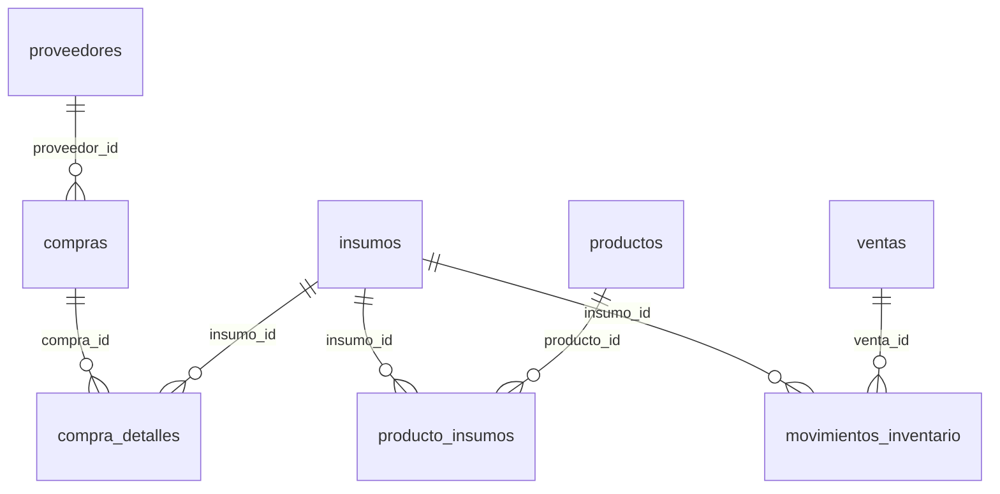

# TITAN GRILL — AUDITORÍA PRE-IMPLEMENTACIÓN
## Costos de Insumos + Recetas + UX
**Fecha:** 2026-08-31
**Autor:** Auditoría automática (solo lectura)
**Estado:** ✅ SOLO LECTURA — Ningún archivo de código, tabla o dato fue modificado

---

## ÍNDICE

1. [Estado actual](#1-estado-actual)
2. [Cómo funciona actualmente el costo de insumos](#2-cómo-funciona-actualmente-el-costo-de-insumos)
3. [Cómo funcionan actualmente las compras](#3-cómo-funcionan-actualmente-las-compras)
4. [Cómo funcionan actualmente las recetas](#4-cómo-funcionan-actualmente-las-recetas)
5. [Cómo se calculan actualmente los costos](#5-cómo-se-calculan-actualmente-los-costos)
6. [Cómo funciona actualmente el precio de venta](#6-cómo-funciona-actualmente-el-precio-de-venta)
7. [Cómo funcionan actualmente los márgenes](#7-cómo-funcionan-actualmente-los-márgenes)
8. [Estructura Supabase relevante](#8-estructura-supabase-relevante)
9. [RPC relevantes](#9-rpc-relevantes)
10. [Datos existentes relevantes](#10-datos-existentes-relevantes)
11. [Análisis de unidades y conversiones](#11-análisis-de-unidades-y-conversiones)
12. [Impacto de la Mejora 1 — Costo desde la compra](#12-impacto-de-la-mejora-1)
13. [Impacto de la Mejora 2 — Botón POS](#13-impacto-de-la-mejora-2)
14. [Impacto de la Mejora 3 — Submenú de costos en recetas](#14-impacto-de-la-mejora-3)
15. [Riesgos](#15-riesgos)
16. [Propuesta de arquitectura](#16-propuesta-de-arquitectura)
17. [Propuesta de UI](#17-propuesta-de-ui)
18. [Fórmulas exactas](#18-fórmulas-exactas)
19. [Qué debe permanecer intacto](#19-qué-debe-permanecer-intacto)
20. [Qué archivos/componentes habría que modificar](#20-qué-archivos-componentes-habría-que-modificar)
21. [Qué tablas/columnas/RPC habría que modificar](#21-qué-tablas-columnas-rpc-habría-que-modificar)
22. [Si se requiere migración](#22-si-se-requiere-migración)
23. [Estrategia recomendada de implementación](#23-estrategia-recomendada-de-implementación)
24. [Plan de pruebas posterior](#24-plan-de-pruebas-posterior)

---

## 1. Estado actual

### Resumen de tablas relevantes

| Tabla | Filas | Propósito |
|-------|-------|-----------|
| `insumos` | 48 | Catálogo de materias primas (con costo_unitario y stock) |
| `productos` | 11 | Catálogo de productos (con precio de venta) |
| `producto_insumos` | 58 | Receta: relación producto ↔ insumo (cantidad_por_unidad) |
| `compras` | 0 | Órdenes de compra (sin datos aún) |
| `compra_detalles` | 0 | Detalle de cada compra (sin datos aún) |
| `movimientos_inventario` | 7 | Historial de entrada/salida de stock |
| `ventas` | 0 | Ventas realizadas |
| `costos_configuracion` | 0 | Tabla de configuración de costos (VACÍA — sin usar) |
| `proveedores` | 3 | Proveedores registrados |

### Tecnología

- **Frontend:** React SPA con Vite, Tailwind v4
- **Backend:** Supabase (PostgreSQL, Auth, RLS, RPC functions)
- **Componente principal:** [AdminDashboard.jsx](file:///e:/Documents/titan_grill/src/components/AdminDashboard.jsx) (~6.884 líneas, contiene TODO el panel de admin)

---

## 2. Cómo funciona actualmente el costo de insumos

### ¿Dónde se guarda el costo unitario?

En la columna `insumos.costo_unitario` (tipo `numeric`, nullable, default 0).

El costo unitario se almacena directamente en el registro del insumo como un **valor plano** que el administrador ingresa manualmente en el formulario de edición.

### Formulario actual del insumo ([línea 75](file:///e:/Documents/titan_grill/src/components/AdminDashboard.jsx#L75)):

```javascript
{ nombre: '', unidad_medida: 'unidad', stock_actual: 0, stock_minimo: 0, activo: true, costo_unitario: 0 }
```

**Campos disponibles:** Nombre, Unidad de medida, Costo Unitario ($) — ingresado manualmente, Stock Actual, Alerta Stock Mínimo, Activo (toggle).

> [!WARNING]
> **NO existe cálculo automático del costo unitario.** El administrador debe calcular mentalmente o con calculadora cuánto cuesta cada gramo/unidad/ml y escribirlo a mano.
>
> Ejemplo real: "Ajo en Polvo" tiene `costo_unitario: 5000` en unidad `gramo`. Esto sugiere que se ingresó el precio total de la bolsa ($5.000) en el campo de costo unitario, **NO el costo por gramo.** Esto es un **error conceptual** en los datos actuales.

---

## 3. Cómo funcionan actualmente las compras

### Estructura de `compras`:

| Columna | Tipo | Descripción |
|---------|------|-------------|
| `id` | uuid | PK |
| `proveedor_id` | uuid | FK → proveedores |
| `usuario_id` | uuid | FK → auth.users |
| `fecha` | timestamptz | Fecha de la compra |
| `total` | numeric | Total calculado al recibir (default 0) |
| `estado` | text | 'BORRADOR' → 'RECIBIDA' → 'ANULADA' |
| `observaciones` | text | Notas |
| `metodo_pago` | text | EFECTIVO / NEQUI / BANCOLOMBIA |

### Estructura de `compra_detalles`:

| Columna | Tipo | Descripción |
|---------|------|-------------|
| `id` | uuid | PK |
| `compra_id` | uuid | FK → compras |
| `insumo_id` | uuid | FK → insumos |
| `cantidad` | numeric | Cantidad comprada (en unidad del insumo) |
| `costo_unitario` | numeric | Costo unitario DEL DETALLE |
| `subtotal` | numeric | cantidad × costo_unitario |

### ¿El sistema tiene info suficiente para calcular costo automáticamente?

**PARCIALMENTE.** La tabla tiene `cantidad` y `costo_unitario`, pero:
1. El admin debe calcular el costo unitario antes de ingresarlo.
2. No hay campo "precio total pagado" ni "contenido comprado".
3. No hay conversión de unidades.

### ¿Qué pasa al recibir una compra? (RPC `recibir_compra`)

```sql
-- Sobrescribe costo_unitario del insumo con el de la compra
UPDATE public.insumos
SET stock_actual = stock_actual + v_detail.cantidad,
    costo_unitario = CASE
      WHEN v_detail.costo_unitario > 0 THEN v_detail.costo_unitario
      ELSE costo_unitario
    END
```

> [!IMPORTANT]
> El costo unitario del insumo se **SOBRESCRIBE** con el de la última compra. No hay promedio ponderado ni historial. Es "último costo" (LIFO en costo).

### Datos actuales: **0 compras y 0 detalles.** El módulo existe pero nunca ha sido utilizado.

---

## 4. Cómo funcionan actualmente las recetas

### Tabla `producto_insumos`:

| Columna | Tipo | Descripción |
|---------|------|-------------|
| `producto_id` | uuid | FK → productos |
| `insumo_id` | uuid | FK → insumos |
| `cantidad_por_unidad` | numeric | Cantidad del insumo requerida para 1 unidad del producto |

> [!IMPORTANT]
> **NO existe campo de "porciones"** ni `numero_porciones`. La receta asume **siempre 1 porción** por producto.

### Ejemplo real — Burger Classic (precio: $14.000):

| Insumo | Cantidad | Unidad | Costo Unit. | Costo Ingrediente |
|--------|----------|--------|-------------|-------------------|
| Carne Especial | 130 | gramo | $16.556 | $2.152 |
| Pan Hamburguesa Art. | 1 | unidad | $1.350 | $1.350 |
| Tocineta | 1 | unidad | $736.67 | $736.67 |
| Queso Chalo | 1 | unidad | $695 | $695 |
| Porción Salsa Acomp. | 1 | porción | $600 | $600 |
| Cabeza de Ajo | 0.2 | unidad | $600 | $120 |
| Cebolla Blanca | 0.2 | unidad | $600 | $120 |
| Lechuga Crespa | 15 | gramo | $19.444 | $291.66 |
| Tomate | 0.2 | unidad | $800 | $160 |
| Mostaza | 10 | gramo | $10.612 | $106.12 |
| Ripia | 10 | gramo | $10.40 | $104 |
| Salsa Tomate Grande | 15 | gramo | $6.744 | $101.16 |
| Orégano en Polvo | 0.5 | gramo | $100 | $50 |
| Cebollín | 2 | gramo | $25 | $50 |
| Servilleta | 3 | unidad | $14 | $42 |
| Pimienta Negra | 0.7 | gramo | $56 | $39.20 |
| **TOTAL** | | | | **≈ $6.718** |

> Costo Standard Total calculado: **~$6.718** | Precio de venta: **$14.000** | Margen de costo estimado: **~48%** | Margen de rentabilidad: **~52%**

---

## 5. Cómo se calculan actualmente los costos

### COGS (P&L) — [líneas 316-320](file:///e:/Documents/titan_grill/src/components/AdminDashboard.jsx#L316-L320):

```javascript
const totalCogs = (saleMovementsRes.data || []).reduce((sum, m) => {
    const qty = Math.abs(Number(m.cantidad || 0));
    const unitCost = Number(m.insumos?.costo_unitario || 0);
    return sum + (qty * unitCost);
}, 0);
```

> [!WARNING]
> Usa el costo unitario **ACTUAL** del insumo, no el costo al momento de la venta. Si el costo cambia, el COGS histórico cambia retroactivamente.

### Costo de receta:

> **NO se calcula en ningún lugar del sistema.** No existe función, vista ni componente que compute `Σ(cantidad × costo_unitario)` para una receta.

---

## 6. Cómo funciona actualmente el precio de venta

- `productos.precio` es un valor fijo ingresado manualmente.
- **NO existe:** multiplicador, margen objetivo, impuesto, ni precio sugerido.
- `costos_configuracion` existe pero está **completamente vacía** (0 filas).

---

## 7. Cómo funcionan actualmente los márgenes

> **NO funcionan.** No existe ningún cálculo de márgenes en el sistema. No hay visualización de rentabilidad por producto.

---

## 8. Estructura Supabase relevante



Todas las tablas tienen **RLS habilitado**.

---

## 9. RPC relevantes

| Función | Relevancia | Impacto |
|---------|-----------|---------|
| `recibir_compra` | 🔴 ALTA | Sobrescribe `insumos.costo_unitario` con el costo de la compra |
| `registrar_venta` | 🟡 MEDIA | Descuenta stock usando receta; no toca costos |
| `anular_compra` | 🟡 MEDIA | Revertiría stock y potencialmente costo |
| `registrar_merma_trabajador` | 🟢 BAJA | Solo descuenta stock |
| `registrar_carga_masiva_inventario` | 🟢 BAJA | Solo ajusta stock |
| `realizar_transferencia_interna` | 🟢 BAJA | Solo mueve stock |

---

## 10. Datos existentes relevantes

| Dato | Valor | Observación |
|------|-------|-------------|
| Insumos totales | 48 | Con costos asignados manualmente |
| Con costo > 0 | ~35 | 13 tienen costo = 0 (sin costear) |
| Unidades usadas | gramo (22), unidad (20), ml (3), Gramos (1), kg (1), porción (1) | **Inconsistencia: "gramo" vs "Gramos" vs "kg"** |
| Recetas | 58 vínculos | 7 productos con receta, 4 sin receta |
| Compras | 0 | Módulo nunca usado |
| Ventas | 0 | Sin ventas registradas |

---

## 11. Análisis de unidades y conversiones

### ¿Existen conversiones actualmente?

**NO.** No existe ninguna tabla, función, constante ni lógica de conversión de unidades.

### Inconsistencias encontradas:

| Valor actual | Debería ser |
|-------------|-------------|
| `Gramos` (1 insumo) | `gramo` |
| `kg` (1 insumo — Carbón) | `kilogramo` |

### Conversiones necesarias:

| De | A | Factor |
|----|---|--------|
| kilogramo → gramo | × 1.000 |
| litro → mililitro | × 1.000 |

### Riesgos de introducir conversiones:

1. 🟡 Datos existentes inconsistentes necesitan normalización primero
2. 🟢 Solo 2 familias de conversión (peso y volumen) — alcance limitado

---

## 12. Impacto de la Mejora 1

### "Costo de Insumos desde la Compra"

| Área | Riesgo | ¿Afecta? |
|------|--------|----------|
| Frontend (formulario compras) | 🟡 Medio | SÍ — rediseñar campos |
| `recibir_compra` RPC | 🟡 Medio | SÍ — ajustar cálculo |
| `compra_detalles` tabla | 🟡 Medio | SÍ — agregar columnas |
| Recetas | 🟢 Bajo | Indirectamente (costos corregidos) |
| Inventario/Stock | 🟢 Bajo | NO — solo cambia cómo se ingresa costo |
| Mermas/Transferencias | 🟢 Bajo | NO |
| Ventas históricas | 🟢 Bajo | NO hay ventas |

**Clasificación: B) Frontend + base de datos**

---

## 13. Impacto de la Mejora 2

### "Eliminar emoji 🔥 del botón POS"

Ubicación exacta: [línea 1932](file:///e:/Documents/titan_grill/src/components/AdminDashboard.jsx#L1932)

```jsx
🔥 POS  // ← eliminar el emoji
```

| Ubicación | Línea | Texto actual | ¿Tiene 🔥? |
|-----------|-------|-------------|------------|
| Header móvil | 1932 | `🔥 POS` | ✅ ELIMINAR |
| Drawer móvil | 2019 | `Abrir Caja / POS` | ❌ NO |
| Dashboard caja | 2699 | `Ir al POS` | ❌ NO |
| Sección ventas | 3045 | `Nueva Venta (POS)` | ❌ NO |

**Clasificación: A) Solo frontend — cambio trivial de 1 línea, riesgo 🟢 cero**

---

## 14. Impacto de la Mejora 3

### "Submenú/Resumen de Costos en cada Receta"

UI actual ([líneas 5351-5505](file:///e:/Documents/titan_grill/src/components/AdminDashboard.jsx#L5351-L5505)): lista de insumos con cantidad y unidad. **SIN costos, SIN totales, SIN márgenes.**

### Datos que faltan:

| Dato | ¿Existe? | ¿Dónde? |
|------|----------|---------|
| Costo unitario del insumo | ✅ | `insumos.costo_unitario` |
| Cantidad por unidad | ✅ | `producto_insumos.cantidad_por_unidad` |
| Precio de venta | ✅ | `productos.precio` |
| Número de porciones | ❌ | **NO EXISTE** |
| Multiplicador de precio | ❌ | **NO EXISTE** |
| % de impuesto / IPC | ❌ | **NO EXISTE** |

**Clasificación: C) Frontend + base de datos (nuevas columnas)**

---

## 15. Riesgos

### 🔴 Riesgos altos:

1. **Datos de costo incorrectos en producción.** "Ajo en Polvo" costo_unitario=5000/gramo — si se muestra en el bloque de costos sin corregir, mostrará valores absurdos.
2. **COGS no usa snapshots históricos.** Corregir costos cambia el P&L retroactivamente. (Mitigado: 0 ventas actualmente.)

### 🟡 Riesgos medios:

3. **Inconsistencia de unidades** — "Gramos" vs "gramo", "kg" vs "kilogramo".
4. **AdminDashboard.jsx monolítico** (6.884 líneas) — cada cambio aumenta riesgo de regresión.
5. **13 insumos con costo = $0** — subestiman costos reales.

### 🟢 Riesgos bajos:

6. **0 compras, 0 ventas** — no hay datos históricos que migrar.
7. **Mejora 2** — sin riesgo.

---

## 16. Propuesta de arquitectura

### Mejora 1 — Costo desde la compra

Agregar columnas a `compra_detalles`:
```sql
ALTER TABLE compra_detalles ADD COLUMN precio_total_pagado numeric;
ALTER TABLE compra_detalles ADD COLUMN contenido_comprado numeric;
ALTER TABLE compra_detalles ADD COLUMN unidad_compra text;
```

Constantes de conversión en frontend:
```javascript
const CONVERSIONES = {
  'kilogramo→gramo': 1000,
  'gramo→kilogramo': 0.001,
  'litro→mililitro': 1000,
  'mililitro→litro': 0.001,
};
```

### Mejora 2 — Botón POS

```diff
- 🔥 POS
+ POS
```

### Mejora 3 — Costos de receta

Nuevas columnas en `productos`:

| Columna | Tipo | Default |
|---------|------|---------|
| `numero_porciones` | numeric | 1 |
| `multiplicador_precio` | numeric | NULL |
| `impuesto_porcentaje` | numeric | NULL |

> **Nota sobre impuesto:** El admin pidió que el porcentaje sea configurable. Se puede implementar como campo por producto O como configuración global (reutilizando `costos_configuracion`).

---

## 17. Propuesta de UI

### Receta con bloque de costos:

```
┌──────────────────────────────────────────────┐
│ Burger Classic                   16 insumos  │
│                                              │
│  ▼ COSTOS Y RENTABILIDAD                     │
│  ┌──────────────────────────────────────────┐│
│  │ Costo Standard Total      $6.718         ││
│  │ Costo Standard / Porción  $6.718         ││
│  │ ─────────────────────────────────────────││
│  │ Precio Sug. sin Impuesto  $13.436  (×2)  ││
│  │ Precio Sug. con Impuesto  $14.511  (+8%) ││
│  │ ─────────────────────────────────────────││
│  │ Precio Aprobado           $14.000        ││
│  │ ─────────────────────────────────────────││
│  │ Margen de Costo           47.99%         ││
│  │ Margen de Rentabilidad    52.01%         ││
│  └──────────────────────────────────────────┘│
│                                              │
│  ▶ INSUMOS DE LA RECETA                      │
│    Pan Hamburguesa...     1 unidad    $1.350 │
│    Carne Especial       130 gramo     $2.152 │
│    ...                                       │
└──────────────────────────────────────────────┘
```

### Formulario de compra mejorado:

```
┌──────────────────────────────────────────────┐
│ Agregar Insumo a la Compra                   │
│                                              │
│ Insumo:           [Ajo en Polvo ▼]           │
│ Unidad base:      gramo (auto)               │
│                                              │
│ Precio Total ($): [5.000]                    │
│ Contenido:        [500]                      │
│ Unidad Contenido: [gramos ▼]                 │
│                                              │
│ ─────────────────────────────────────────────│
│ COSTO UNITARIO CALCULADO: $10 / gramo   ✅   │
└──────────────────────────────────────────────┘
```

---

## 18. Fórmulas exactas

### Glosario (NO confundir):

| # | Concepto | Definición |
|---|----------|------------|
| 1 | Costo de compra | Precio total pagado al proveedor |
| 2 | Costo unitario del insumo | PrecioCompra ÷ ContenidoEnUnidadBase |
| 3 | Costo del ingrediente | cantidad_por_unidad × costo_unitario |
| 4 | Costo Standard Total | Σ costos de todos los ingredientes |
| 5 | Costo Standard por Porción | Costo Total ÷ porciones |
| 6 | Precio sugerido sin impuesto | Costo/Porción × multiplicador |
| 7 | Precio sugerido con impuesto | Precio sin imp × (1 + %impuesto/100) |
| 8 | Precio aprobado | Valor manual del administrador |
| 9 | Margen de costo | (Costo/Porción ÷ Precio Aprobado) × 100 |
| 10 | Margen de rentabilidad | 100% − Margen de Costo |

### Fórmulas:

```
1. costo_unitario = precio_total / (contenido × factor_conversion)
2. costo_ingrediente = cantidad_por_unidad × costo_unitario_insumo
3. costo_standard_total = Σ costo_ingrediente
4. costo_por_porcion = costo_standard_total / numero_porciones
5. precio_sug_sin_imp = costo_por_porcion × multiplicador
6. precio_sug_con_imp = precio_sug_sin_imp × (1 + impuesto/100)
7. precio_aprobado = productos.precio (manual, NUNCA sobrescrito)
8. margen_costo = (costo_por_porcion / precio_aprobado) × 100
9. margen_rentabilidad = 100 - margen_costo
```

---

## 19. Qué debe permanecer intacto

| Elemento | Razón |
|----------|-------|
| `insumos.costo_unitario` | Usado por P&L y vistas |
| `producto_insumos.cantidad_por_unidad` | Usado por `registrar_venta` |
| `productos.precio` | Precio de venta actual |
| `registrar_venta` RPC | No requiere cambios |
| Módulos: fidelización, caja, sesiones, liquidaciones | Independientes |
| Archivo `.env` | Nunca modificar |

---

## 20. Qué archivos/componentes habría que modificar

| Archivo | Mejora | Cambio |
|---------|--------|--------|
| [AdminDashboard.jsx](file:///e:/Documents/titan_grill/src/components/AdminDashboard.jsx) | 1, 2, 3 | Formulario compras, botón POS, sección recetas |

> Todo el cambio frontend se concentra en **UN solo archivo**.

---

## 21. Qué tablas/columnas/RPC habría que modificar

### Cambios DB:

| Tabla | Cambio | Columna | Obligatorio |
|-------|--------|---------|-------------|
| `compra_detalles` | ADD COLUMN | `precio_total_pagado` numeric | SÍ (Mejora 1) |
| `compra_detalles` | ADD COLUMN | `contenido_comprado` numeric | SÍ (Mejora 1) |
| `compra_detalles` | ADD COLUMN | `unidad_compra` text | SÍ (Mejora 1) |
| `productos` | ADD COLUMN | `numero_porciones` numeric DEFAULT 1 | RECOMENDADO (Mejora 3) |
| `productos` | ADD COLUMN | `multiplicador_precio` numeric | OPCIONAL |
| `productos` | ADD COLUMN | `impuesto_porcentaje` numeric | OPCIONAL |

### Cambios RPC:

| RPC | Cambio | Detalle |
|-----|--------|---------|
| `recibir_compra` | MODIFICAR | Calcular costo_unitario desde nuevos campos |
| Todas las demás | SIN CAMBIOS | — |

---

## 22. Si se requiere migración

| Dato | ¿Requiere? | Detalle |
|------|-----------|---------|
| `insumos.costo_unitario` | 🟡 LIMPIEZA | Corregir datos erróneos (Ajo en Polvo, etc.) |
| `insumos.unidad_medida` | 🟡 NORMALIZACIÓN | "Gramos"→"gramo", "kg"→"kilogramo" |
| Compras / Ventas | ❌ | 0 registros — sin migración |

> ⚠️ La corrección de costos **requiere input del administrador** para cada insumo sospechoso.

---

## 23. Estrategia recomendada de implementación

```
FASE 0: Preparación (sin riesgo)
├── 0.1 Normalizar unidades en DB
├── 0.2 Corregir costos unitarios CON EL ADMIN
└── 0.3 Decidir: ¿impuesto/multiplicador global o por producto?

FASE 1: Mejora 2 — Botón POS (1 minuto, riesgo cero)
└── Eliminar 🔥 de línea 1932

FASE 2: Mejora 1 — Costo desde compra (medio)
├── 2.1 Agregar columnas a compra_detalles
├── 2.2 Agregar constantes de conversión
├── 2.3 Rediseñar formulario de compra
├── 2.4 Calcular costo_unitario automáticamente
├── 2.5 Ajustar RPC recibir_compra
└── 2.6 Probar con compra de prueba

FASE 3: Mejora 3 — Submenú de costos (medio-alto)
├── 3.1 Agregar columnas a productos
├── 3.2 Agregar bloque [▼ COSTOS Y RENTABILIDAD]
├── 3.3 Calcular fórmulas en frontend
├── 3.4 Agregar costo por ingrediente en lista
├── 3.5 Agregar config para multiplicador e impuesto
└── 3.6 Probar con todos los productos
```

---

## 24. Plan de pruebas posterior

### Mejora 1:
- [ ] Compra de prueba: 5 kg carne × $100.000 → costo = $20/gramo
- [ ] Recibir compra → verificar `insumos.costo_unitario` = 20
- [ ] Compra en misma unidad: 500g × $10.000 = $20/gramo
- [ ] Compra litros con receta en ml

### Mejora 2:
- [ ] Botón dice "POS" sin 🔥
- [ ] Sigue navegando a `/pos`
- [ ] Drawer "Abrir Caja / POS" no cambió

### Mejora 3:
- [ ] Burger Classic muestra costo total ≈ $6.718
- [ ] Porciones=2 → costo/porción = $3.359
- [ ] Multiplicador=2 → precio sugerido = $13.436
- [ ] Impuesto=8% → precio con imp = $14.511
- [ ] Precio aprobado ($14.000) NO se sobrescribe
- [ ] Margen costo = 47.99%, rentabilidad = 52.01%

### Regresión:
- [ ] `npm run lint` pasa
- [ ] `npm run build` pasa
- [ ] POS funciona, ventas se registran, inventario descuenta

---

## CONFIRMACIONES FINALES

| Verificación | Estado |
|-------------|--------|
| ¿Se modificó algún archivo de código? | ❌ NO |
| ¿Se modificó Supabase? | ❌ NO |
| ¿Se hizo commit? | ❌ NO |
| ¿Se hizo push? | ❌ NO |

---

## RESUMEN EJECUTIVO

| Pregunta | Respuesta |
|----------|-----------|
| **¿Se puede implementar?** | ✅ Sí, las 3 mejoras son viables |
| **¿Qué tan grande es el cambio?** | Mejora 1: Medio · Mejora 2: Trivial · Mejora 3: Medio-Alto |
| **¿Qué riesgo tiene?** | 🟡 Medio — riesgo principal: calidad de datos de costo actuales |
| **¿Qué requiere base de datos?** | Mejora 1: 3 columnas + RPC. Mejora 3: 3 columnas |
| **¿Qué es solo frontend?** | Mejora 2 (100%). Mejora 3 es ~90% frontend |
| **¿Qué hacer primero?** | Fase 0 (limpiar datos) → Fase 1 (POS) → Fase 2 (compras) → Fase 3 (recetas) |
| **¿Qué NO tocar?** | `registrar_venta`, fidelización, caja, sesiones, liquidaciones, `.env` |
